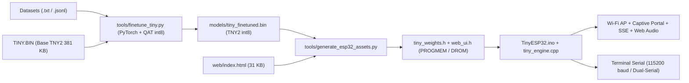

# TINY 2.1 ESP32 Portable — Transformer de 367K Parâmetros no ESP32 + Fine-Tuning Local


Este repositório é um fork do **TINY 2.1** — originalmente um Transformer *char-level* de perguntas e respostas escrito em **Turbo C 2.0** para rodar sob **MS-DOS** em um 486DX/Pentium (escrito por Fable 5.2 e treinado por Opus 5.5) — agora **portado integralmente para ESP32** (Arduino IDE, **zero bibliotecas externas**, compatível com placas sem PSRAM) e equipado com um **pipeline completo de fine-tuning local em PyTorch com QAT (`int8`) e GPU CUDA**.

---

## O Que Foi Construído Neste Fork

1. **Motor Neural Zero-Copy para ESP32 ([`TinyESP32/tiny_engine.h`](TinyESP32/tiny_engine.h), [`TinyESP32/tiny_engine.cpp`](TinyESP32/tiny_engine.cpp)):**
   - Executa os **381.808 bytes** de pesos (`367.000` parâmetros) **direto da memória Flash (`PROGMEM` / `DROM`)**, consumindo **0 bytes de RAM para os pesos**.
   - Aloca o **KV Cache quantizado em `int8`** dinamicamente no heap (`~100 KB`), rodando em **ESP32 clássico (WROOM, sem PSRAM)**, **ESP32-S3**, **ESP32-C3**, **ESP32-C6** e **ESP32-S2**.
   - Usa exclusivamente FPU de precisão simples (`float` 32 bits, `sqrtf`, `expf`), desenrolamento `4x` no produto escalar e `yield()` por token para manter Wi-Fi e Watchdog saudáveis.
   - Inclui transliteração automática de acentos UTF-8 Latin-1 (`ã`, `ç`, `é`, `ó`...) para ASCII na entrada do usuário (`tiny_clean_question`).

2. **Firmware ESP32 Completo com Interface Web Neon, Captive Portal e Dual-Serial ([`TinyESP32/TinyESP32.ino`](TinyESP32/TinyESP32.ino), [`web/index.html`](web/index.html)):**
   - **Interface Web Neon via Wi-Fi:** recria no navegador do celular e do PC a estética VGA retrô do DOS, com chuva digital de boot, scanner de leitura, painel **NEURAL MONITOR** em tempo real (`LAYER ACTIVITY`, `CONFIDENCE`, `LAST LETTERS`, `SPEED`) via **Server-Sent Events (SSE)** e **voz robótica estilo PC Speaker** via Web Audio API — 100% offline e comprimida em gzip (`9,3 KB` em [`TinyESP32/web_ui.h`](TinyESP32/web_ui.h)).
   - **Captive Portal (`DNSServer`):** intercepta as verificações de conectividade de Android, iOS e Windows para impedir que celulares desviem `192.168.4.1` para o 4G/5G, além de fixar estabilidade de rádio (`WiFi.setSleep(false)` e `WIFI_POWER_11dBm`).
   - **Dual-Serial (`Serial` + `Serial0`) & Compatibilidade USB CDC:** em placas com USB nativo (`USB CDC On Boot` ativo), espelha entrada e saída nas portas `USB` e `UART`, aguarda a reenumeração USB no boot, reenvia o banner quando o Serial Monitor é aberto depois e suporta envio em `"Newline"`, `"Both NL & CR"` e `"No Line Ending"`.

3. **Pipeline de Fine-Tuning com QAT (`int8`) e GPU CUDA ([`tools/finetune_tiny.py`](tools/finetune_tiny.py)):**
   - Carrega o binário `TNY2` em PyTorch, treina apenas sobre a resposta (**Answer-Only SFT**) com **Quantization-Aware Training (`int8` STE)** simulando pesos e KV Cache reais do ESP32, **L2-SP** e **Replay Buffer autodestilado** para evitar esquecimento catastrófico.
   - Detecta e acelera automaticamente em **GPU NVIDIA CUDA** (incluindo arquitetura Blackwell / RTX 5060 Ti com `cu128`), Apple MPS, Intel XPU ou CPU.
   - Exporta no formato binário exato `TNY2`, valida com inferência quantizada real e atualiza [`TinyESP32/tiny_weights.h`](TinyESP32/tiny_weights.h) com `--update-esp32` (ou restaura para o original com `--restore-esp32`).

4. **Ferramentas de Dataset, Empacotamento e Verificação:**
   - [`tools/generate_brazil_dataset.py`](tools/generate_brazil_dataset.py) — gerador do dataset estendido em português/inglês (persona **AMEBA**, 27 capitais/UFs, 6 biomas do IBGE, distâncias Haversine + rodoviárias entre capitais e todos os presidentes da história do Brasil), validando estritamente os limites `MAXQ=72` e `CTX=128`.
   - [`tools/txt_to_jsonl.py`](tools/txt_to_jsonl.py) — converte arquivos `pergunta1 ; pergunta2 | resposta` (`.txt`/`.tsv`) em `.jsonl` agrupado.
   - [`tools/generate_esp32_assets.py`](tools/generate_esp32_assets.py) — empacota qualquer modelo `TNY2` (`.bin`) e `web/index.html` (`gzip -9`) para headers `PROGMEM`.
   - [`tools/verify_port.py`](tools/verify_port.py) — valida integridade bit a bit dos headers, layout de partições, regras estáticas de código embarcado e executa inferência `int8` de ponta a ponta.

---

## Arquitetura do Sistema



### Estrutura de Arquivos

```text
Tiny-2.1-ESP32_portable/
├── TinyESP32/                    # Sketch pronto para Arduino IDE
│   ├── TinyESP32.ino             # Firmware principal (Wi-Fi AP/STA, Captive Portal, HTTP/SSE, Serial)
│   ├── tiny_engine.h / .cpp      # Motor Transformer Zero-Copy na Flash + KV Cache int8 no Heap
│   ├── tiny_weights.h            # Pesos TNY2 alinhados em uint32_t PROGMEM (381.808 B)
│   ├── web_ui.h                  # web/index.html comprimido com gzip -9 (~9,3 KB)
│   └── partitions.csv            # Tabela de partições (app0 = 1,87 MB, compatível com Flash 2 MB+)
├── web/
│   └── index.html                # Interface Web Neon offline (Monitor Neural + Voz Robótica)
├── data/
│   ├── custom_qa.txt             # Dataset editável (persona AMEBA + Brasil: 1.476 pares)
│   └── custom_qa.jsonl           # Mesmo dataset agrupado em JSONL (468 registros)
├── models/
│   └── tiny_finetuned.bin        # Modelo gerado após fine-tuning local
├── tools/
│   ├── finetune_tiny.py          # Treino PyTorch + QAT int8 + chat local + --update-esp32
│   ├── generate_brazil_dataset.py# Gerador do dataset completo sobre o Brasil
│   ├── txt_to_jsonl.py           # Conversor .txt -> .jsonl agrupado
│   ├── generate_esp32_assets.py  # Gerador de tiny_weights.h e web_ui.h
│   └── verify_port.py            # Suíte automatizada de verificação e simulação int8
├── README.md                     # Este guia completo do fork
├── README_ESP32.md               # Referência rápida de compilação ESP32 e fine-tuning
├── TINY.C / TINY.BIN / TINY.EXE  # Arquivos originais do MS-DOS preservados intactos
└── BUILD.BAT / README.TXT        # Build e manual originais de Turbo C 2.0
```

---

## Como Tudo Funciona por Dentro

### 1. O Transformer Char-Level (`D=96, L=4, H=4, HID=256`)

O TINY não usa tokenizador BPE nem subpalavras: ele lê e gera **caractere por caractere**.

- **Vocabulário (`VOCAB = 97`):**
  - `0` = padding (`PAD`)
  - `1` = separador de fim de pergunta / fim de resposta (`\n`)
  - `2..96` = caracteres ASCII imprimíveis `' '..'~'` (`32..126`), mapeados por `tok = ord(c) - 30`.
- **Janela de Contexto (`CTX = 128`, `MAXQ = 72`):** a soma `len(pergunta) + 1 + len(resposta)` precisa caber em `128` posições. Na entrada (`tiny_clean_question`), sequências UTF-8 acentuadas (`0xC3 0x80..0xBF`) são transliteradas para ASCII equivalente (`ã -> a`, `ç -> c`, `é -> e`) para que perguntas em português funcionem naturalmente.
- **Fluxo matemático de cada token (`step(tok, p)`):**
  1. **Embeddings:** soma o vetor do caractere `emb[tok]` com o embedding posicional `pos[p]` (cada um de tamanho `D = 96`).
  2. **4 Camadas Transformer (`L = 4`):**
     - **RMSNorm (`norm`):** normaliza pela raiz da média quadrática com `eps = 1e-5` (sem bias) e multiplica pelos ganhos `g1[l]`.
     - **Atenção Causal Multi-Head (`H = 4`, `HD = 24`):** calcula `Q`, `K`, `V` via `matvec` sem bias. Em seguida, **`store()` quantiza `K` e `V` dinamicamente para `int8` (`[-127, 127]`) + 1 `float` de escala por posição**, gravando no KV Cache (`kc`, `vc`, `ks`, `vs`). Essa compressão reduz o KV Cache em **~3,8x** (de ~393 KB em `float32` para **102.400 bytes**), tornando viável rodar no ESP32 sem PSRAM.
     - **Feed-Forward (`MLP`):** aplica RMSNorm (`g2[l]`), projeta de `96 -> 256` (`f1[l]`), aplica **ReLU** (coletando a ativação média `layer_act[l]` para o gráfico ao vivo do Monitor Neural) e projeta de volta `256 -> 96` (`f2[l]`).
  3. **Weight Tying na saída:** após `norm(bx, gf, bh)`, projeta os `96` canais de volta para os `97` logits reutilizando a própria tabela de embeddings `emb` (`97 × 96`).
  4. **Amostragem (`pick`):** com `creativity = 0`, escolhe sempre o maior score (*greedy*). Com `1..9`, aplica temperatura `T = creativity / 5.0`, zera probabilidades relativas `< 0.15` para evitar letras absurdas e sorteia a próxima letra, calculando também a confiança (`last_conf = 1 / sum_exp`).

### 2. Formato Binário `TNY2` e Execução Zero-Copy na Flash do ESP32

No código original de DOS, `TINY.EXE` lia `TINY.BIN` do disco e alocava todas as tabelas na RAM convencional (~540 KB). No ESP32 clássico (apenas ~320 KB de DRAM utilizável ao lado da pilha Wi-Fi), copiar `381.808` bytes para a RAM é inviável.

A solução adotada foi o **mapeamento Zero-Copy em Flash (`DROM`)**:

- **Layout exato de `TINY.BIN` (`381.808` bytes):**
  - **Cabeçalho (12 bytes):** `"TNY2"` + quatro `uint16_t` little-endian (`D=96`, `L=4`, `H=4`, `HID=256`).
  - **Tabelas intercaladas linha a linha:** cada linha armazena `[float32 scale (4 B)][int8_t w[cols] (cols B)]`. Como `D = 96` e `HID = 256` são múltiplos de 4, **todas as escalas e vetores de ganhos (`g1`, `g2`, `gf`) caem naturalmente em endereços múltiplos de 4 bytes**.
- **Alinhamento garantido em `PROGMEM`:** [`tools/generate_esp32_assets.py`](tools/generate_esp32_assets.py) grava o binário em [`TinyESP32/tiny_weights.h`](TinyESP32/tiny_weights.h) como `static const uint32_t TINY_BIN_U32[95452] PROGMEM`. Isso força alinhamento de 4 bytes no Flash MMU (`DROM`), acelera a compilação no `g++` e permite leitura segura sem *strict-aliasing* via `memcpy` + `__builtin_assume_aligned(p, 4)`.
- **Heap vs `.bss` no Xtensa:** em vez de arrays globais estáticos que estourariam o segmento `dram0_0_seg` ao linkar com `<WiFi.h>`, os 16 blocos do KV Cache (`~100 KB`) são alocados com `malloc()` dentro de `tiny_init()` no início do `setup()` (ou automaticamente em `ps_malloc()` caso o heap interno esteja abaixo de 180 KB e haja PSRAM).
- **Otimização de FPU:** o núcleo Xtensa LX6/LX7 tem FPU em hardware apenas para `float` (32 bits); `double` roda em emulação por software. Todo o motor usa `sqrtf`, `expf` e literais `f`, e `matvec()` desenrola o laço interno em 4 acumuladores independentes (`s0..s3`) para esconder a latência do pipeline de `madd.s`.

| Recurso | Memória | Tamanho | Observação |
| --- | --- | --- | --- |
| Pesos `TNY2` (`tiny_weights.h`) | Flash (`PROGMEM` / DROM) | **381.808 B** (~373 KB) | Zero-copy direto da Flash (`0 B` de RAM) |
| Interface Web (`web_ui.h`) | Flash (`PROGMEM` / DROM) | **~9,3 KB** | Gzip nível 9 (`31,6 KB` descomprimida) |
| KV Cache (`kc`, `vc`, `ks`, `vs`) | SRAM Heap (`malloc`) | **102.400 B** (100 KB) | 4 camadas × 128 tokens × (`96` `int8` + `4 B` escala) × 2 |
| Buffers de trabalho (`bx..score`) | SRAM Estática | **~5,5 KB** | Reutilizados a cada passo |
| Partição da Aplicação (`app0`) | Flash (`partitions.csv`) | **1.920 KB** (`0x1E0000`) | Layout total até `0x200000` (compatível com Flash `2 MB+`) |

### 3. Servidor Web, Streaming SSE, Captive Portal e Voz Robótica

- **Servindo a UI sem SPIFFS/LittleFS:** a rota `GET /` envia `INDEX_HTML_GZ` direto da Flash com `Content-Encoding: gzip` usando a sobrecarga de 4 argumentos de `WebServer::send_P`. Não é necessário gravar sistema de arquivos separado na Flash.
- **Streaming em tempo real (`GET /api/ask`):** abre uma resposta `text/event-stream` (`TCP_NODELAY`) e transmite os eventos gerados pelos callbacks de `tiny_think()` enquanto o ESP32 calcula cada token:
  - `{"t":"s","i":...,"n":...,"a":[...]}` — progresso do scanner lendo a pergunta e ativação das 4 camadas;
  - `{"t":"l","c":"...","f":...,"a":[...]}` — cada letra decodificada em tempo real, com sua confiança e atividades de camada;
  - `{"t":"d","ltr":...,"ms":...,"heap":...}` — finalização com velocidade (`letters/s`) e heap livre.
- **Acesso no celular sem bloqueio do 4G/5G:** celulares modernos abandonam redes Wi-Fi sem acesso à internet. O `DNSServer` responde a qualquer domínio com `192.168.4.1` e redireciona `/generate_204` (Android), `/hotspot-detect.html` (iOS) e `/connecttest.txt` (Windows) para a interface do TINY. Se um roteador STA salvo não responder em 8s, o ESP32 fixa o modo `WIFI_AP` para evitar quedas por varredura de canais.
- **Voz Robótica no navegador:** [`web/index.html`](web/index.html) porta a lógica sonora de `TINY.C` para a **Web Audio API** usando um `OscillatorNode` de onda quadrada (`square`): vogais alternam dois formantes a cada `2 ms` (`playBuzz`), fricativas como `s/z/f/h` geram ruído tonal entre `2500–7000 Hz` (`playHiss`), oclusivas (`p/t/k`) emitem cliques curtos e o tom cai gradualmente ao longo da frase (`shift` de `115` até `85`), iluminando cada palavra falada em verde-menta escuro.

### 4. Como Funciona o Fine-Tuning ([`tools/finetune_tiny.py`](tools/finetune_tiny.py))

- **Paridade exata de grafo e QAT (`int8`):** ao carregar um `.bin` (`from_tny2`), o script dequantiza as tabelas para `float32`, mas durante o treino (`--qat`, ligado por padrão) aplica **Straight-Through Estimator (`ste_int8`)** simulando a quantização `int8` por linha nos pesos e por token em `K`/`V`. Assim, o modelo aprende já adaptado à perda de precisão que ocorrerá ao exportar para o ESP32.
- **Answer-Only SFT & Detecção de EOS:** a função de custo (`cross_entropy`) aplica `ignore_index=-100` nos tokens da pergunta e no padding, otimizando exclusivamente os tokens da resposta até o token de parada detectado automaticamente no modelo base (`eos_tok = 1`).
- **Prevenção de Esquecimento Catastrófico:**
  - **L2-SP (`--l2-sp`):** penaliza desvios médios quadráticos dos pesos em relação aos pesos iniciais carregados do modelo base.
  - **Replay autodestilado (`--replay-ratio`):** antes de treinar, o próprio modelo base gera respostas para `30` perguntas-âncora (`ANCHOR_QUESTIONS`) e as mistura nas épocas de treino, preservando o conhecimento prévio sem introduzir conflitos de estilo.
- **Aceleração em GPU e CPU:** o `collate_batch` monta os tensores em arrays NumPy pré-alocados e agrupa sequências por comprimento semelhante (*length bucketing*), evitando padding desperdiçado. Se uma GPU CUDA estiver disponível (`--device auto`), todo o modelo e os batches rodam na GPU.
- **Observação sobre capacidade (`367K` parâmetros):** uma rede com `D=96` e `4` camadas é extremamente enxuta. Ela memoriza e generaliza muito bem personalidade, capitais, biomas, presidentes e comandos; ao treinar datasets grandes com muitas centenas de pares numéricos (como todas as distâncias entre capitais), é recomendável aumentar `--epochs` (ex.: `60`–`100`) e reduzir `--l2-sp` / `--replay-ratio` para dar margem de ajuste aos pesos.

---

## Guia Prático de Uso

### 1. Compilar e Gravar no ESP32 (Arduino IDE)

1. Instale o pacote **esp32 by Espressif Systems** no *Boards Manager* da Arduino IDE (compatível com **v2.x** e **v3.x**).
2. Abra [`TinyESP32/TinyESP32.ino`](TinyESP32/TinyESP32.ino).
3. Configure em **Tools (Ferramentas)**:
   - **ESP32 clássico (WROOM / DevKit V1):** `Board: ESP32 Dev Module`, `Partition Scheme: Huge APP (3MB No OTA/1MB SPIFFS)` (o [`TinyESP32/partitions.csv`](TinyESP32/partitions.csv) local também configura automaticamente `1,87 MB` de `app0` em Flash `2 MB+`).
   - **ESP32-S3 (ex.: N16R8):** `USB Mode: Hardware CDC and JTAG`, `USB CDC On Boot: Enabled`, `Flash Mode: DIO`, `PSRAM: OPI PSRAM` (se houver).
   - **ESP32-C3 / C6 / S2:** `USB CDC On Boot: Enabled`, `Flash Mode: DIO`.
4. Clique em **Upload**.

### 2. Usar via Wi-Fi (Celular / PC) e Serial Monitor

- **Wi-Fi (Access Point direto):**
  1. No celular, desligue os **Dados Móveis (4G/5G)** temporariamente (ou aceite *"Manter conectado"* quando avisar que não há internet).
  2. Conecte na rede **`TINY-2.1-ESP32`** e acesse **`http://192.168.4.1`** (ou use o popup de Captive Portal).
  3. Na interface, você pode clicar em **DEMO**, alternar som (**F2**), voz robótica (**F3**), criatividade `0..9` (**F4**) e configurar o Wi-Fi da sua casa em **WIFI**.
- **Serial Monitor (`115200` baud):**
  - Aceita perguntas diretamente e os comandos:
    - `/0` .. `/9`: ajusta `creativity` (`0` = padrão determinístico, `1..9` = variação progressiva)
    - `/demo`: executa perguntas de demonstração em loop
    - `/status`: exibe dimensões, uso de RAM/Flash, heap livre e IPs Wi-Fi
    - `/wifi <ssid> <senha>` ou `/wifi clear`: salva/remove credenciais do roteador na NVS
    - `cls` e `/help`: limpa a tela ANSI / exibe ajuda

### 3. Fazer Fine-Tuning (CPU ou GPU NVIDIA)

#### Preparar ambiente Python (PC)
É necessário Python com `torch` e `numpy`:

- **Para usar sua GPU NVIDIA (ex.: RTX 5060 Ti Blackwell `sm_120`, requer CUDA 12.8+):**
  ```powershell
  python -m pip install --upgrade --force-reinstall torch numpy --index-url https://download.pytorch.org/whl/cu128
  ```
- *(Opcional)* Verifique se a GPU está ativa:
  ```powershell
  python -c "import torch; print(torch.cuda.is_available(), torch.cuda.get_device_name(0) if torch.cuda.is_available() else 'CPU')"
  ```

#### Editar ou gerar o dataset
- Edite [`data/custom_qa.txt`](data/custom_qa.txt) no formato `pergunta1 ; pergunta2 | resposta` e, se quiser gerar o `.jsonl` agrupado:
  ```bash
  python tools/txt_to_jsonl.py data/custom_qa.txt -o data/custom_qa.jsonl
  ```
- Ou regenere o dataset completo do Brasil (com `--all-pairs` para todos os 351 pares entre as 27 capitais):
  ```bash
  python tools/generate_brazil_dataset.py
  ```

#### Treinar, testar no PC e atualizar o ESP32
```bash
# Treina (usa GPU automaticamente se disponível) e atualiza TinyESP32/tiny_weights.h
python tools/finetune_tiny.py --data data/custom_qa.jsonl --no-augment --epochs 60 --batch-size 64 --lr 5e-4 --l2-sp 0.001 --replay-ratio 0.1 --update-esp32

# Testa o modelo quantizado (int8) interativamente no terminal do PC
python tools/finetune_tiny.py --chat --model models/tiny_finetuned.bin

# Restaura TinyESP32/tiny_weights.h para o modelo original de fábrica (TINY.BIN)
python tools/finetune_tiny.py --restore-esp32
```

Depois do `--update-esp32`, basta clicar em **Upload** na Arduino IDE para gravar o modelo ajustado no ESP32.

### 4. Regerar Assets Web e Verificar o Porte

Se editar [`web/index.html`](web/index.html) ou quiser validar todo o projeto antes de gravar:

```bash
python tools/generate_esp32_assets.py --bin models/tiny_finetuned.bin
python tools/verify_port.py
```

---

## Execução Original no MS-DOS (Preservada)

Os arquivos originais do projeto base ([`TINY.EXE`](TINY.EXE), [`TINY.BIN`](TINY.BIN), [`TINY.C`](TINY.C), [`BUILD.BAT`](BUILD.BAT), [`README.TXT`](README.TXT)) permanecem intactos na raiz:

```text
C:\> CD \TINY
C:\TINY> TINY
```

Para recompilar sob MS-DOS com Turbo C 2.0 (modelo *Large*): `TCC -ml TINY.C`.
