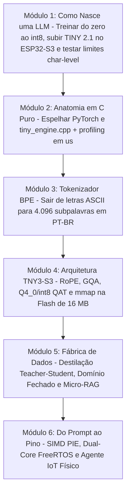

# Curso Prático: Ensinando LLMs no ESP32-S3 (16MB) — Do Silício ao Agente Embarcado

[-blue)](./README.md#hardware-padr%C3%A3o-esp32-s3-wroom-1-16mb)
[](./README.md#mapa-dos-6-m%C3%B3dulos)
[](../README.md)

> **Por que este curso existe?**
> Quase todo material sobre *Large Language Models (LLMs)* começa chamando uma API paga na nuvem ou importando bibliotecas gigantes em Python. Este repositório prova o oposto: você consegue ler, entender, treinar, quantizar e executar um Transformer real dentro de um microcontrolador **ESP32-S3-WROOM-1 (16MB)**, **100% offline** e em menos de **500 linhas de C** ([`TinyESP32/tiny_engine.cpp`](../TinyESP32/tiny_engine.cpp)).
>
> O modelo base deste repositório ([`TINY.BIN`](../TINY.BIN), 367 mil parâmetros) é propositalmente singelo: ele prevê **caractere por caractere**. Ao longo destes **6 módulos**, usamos esse modelo como ponto de partida para o aluno enxergar o Transformer sem caixas-pretas e, passo a passo, evoluí-lo para uma arquitetura moderna (**`TNY3-S3`**) baseada em **subpalavras (BPE)**, **RoPE**, **GQA**, **16 MB de Flash via Zero-Copy** e **aceleração SIMD (PIE)** — capaz de rodar modelos de **5M a 10M de parâmetros** em casos de uso realmente úteis na borda.

---

## Mapa dos 6 Módulos

A jornada é guiada por problemas reais: cada módulo nasce de uma limitação concreta que o aluno descobre na prática no módulo anterior.



| Módulo | Título | Carga Sugerida | O Que o Aluno Constrói / Domina | Link |
| :---: | :--- | :---: | :--- | :---: |
| **01** | **Como Uma LLM Nasce (Do Zero ao Silício)** | 4h | Destrincha como `TINY.BIN`/`AMEBA` foram criados (366.528 params, QAT `int8`), treina uma mini-LLM do zero no PC, sobe no ESP32-S3 e expõe os gargalos do *char-level* | [Abrir Módulo 1](./modulo-01-hello-neural-silicon/README.md) |
| **02** | **Anatomia do Transformer em C** | 4h | Disseca `step()`, `matvec()`, `RMSNorm`, `store()` e `pick()` lado a lado com o PyTorch e mede onde está o gargalo de ciclos | [Abrir Módulo 2](./modulo-02-anatomia-transformer-c/README.md) |
| **03** | **Tokenizador BPE Embarcado** | 4h | Treina um vocabulário BPE em português (`VOCAB = 4.096`), preserva acentos UTF-8 e projeta `tiny_tokenizer` sem `malloc` | [Abrir Módulo 3](./modulo-03-tokenizador-bpe-embarcado/README.md) |
| **04** | **Arquitetura Moderna (`TNY3-S3`)** | 5h | Projeta um modelo de ~5M–10M params com RoPE, GQA, SwiGLU, QAT (`int8`/`Q4_0`) e partição de 8 MB mapeada via `esp_partition_mmap` | [Abrir Módulo 4](./modulo-04-arquitetura-tny3-s3/README.md) |
| **05** | **Fábrica de Dados e Destilação** | 4h | Gera datasets sintéticos limpos (Teacher → Student), implementa `<|act|>` e aposenta as regras manuais com Micro-RAG | [Abrir Módulo 5](./modulo-05-fabrica-dados-destilacao/README.md) |
| **06** | **Projeto Final: Agente com SIMD e Dual-Core** | 5h | Acelera produto escalar com instruções vetoriais `PIE` (`128-bit`), separa Wi-Fi e inferência nos 2 núcleos e aciona hardware real | [Abrir Módulo 6](./modulo-06-agente-embarcado-simd/README.md) |

---

## Hardware Padrão: ESP32-S3-WROOM-1 (16MB)

Adotamos o **ESP32-S3-WROOM-1 (16MB)** como placa oficial do curso por três razões técnicas decisivas para LLMs embarcadas:

1. **16 MB de Flash SPI:** Enquanto um ESP32 clássico de 4 MB limita os pesos a menos de 2 MB junto com a pilha Wi-Fi, os **16 MB** do S3 permitem alocar uma partição dedicada de **8 MB** apenas para pesos neurais (`mmap` zero-copy) e outra de **4 MB** para base de conhecimento offline (Micro-RAG), mantendo **OTA** ou `app0` folgado.
2. **CPU Xtensa LX7 Dual-Core (240 MHz) + Extensão Vetorial PIE:** Além de FPU `float32` em hardware, o S3 traz instruções **SIMD de 128 bits** (*Processor Instruction Extensions*) voltadas especificamente para redes neurais (`int8` / `int16` MACs em paralelo).
3. **USB Nativo (Hardware CDC + JTAG):** Dispensa conversor serial externo para depuração básica e permite fluxo rápido de gravação e inspeção de logs simultâneos.

### Atenção às 3 subvariantes comerciais de 16 MB

Ao comprar placas rotuladas como **ESP32-S3-WROOM-1 (16MB)** (ou placas DevKitC-1 equivalentes), o aluno pode receber uma de três combinações de memória PSRAM:

| Subvariante no Módulo | Flash | SRAM Interna | PSRAM Externa | Ajuste no Menu `Tools` (Arduino IDE) | Como o Curso Trata (`TNY3-S3`) |
| :--- | :---: | :---: | :---: | :--- | :--- |
| **`N16`** | 16 MB (Quad SPI) | 512 KB | **Nenhuma** | `PSRAM: "Disabled"` | Usa GQA (2 KV heads) para caber o KV Cache de `CTX=256` em ~220 KB da SRAM interna |
| **`N16R2`** | 16 MB (Quad SPI) | 512 KB | **2 MB (QSPI)** | `PSRAM: "QSPI PSRAM"` | Ativa `ps_malloc()` automaticamente para ampliar `CTX=512` e buffers de RAG |
| **`N16R8`** *(mais comum)* | 16 MB (Quad SPI) | 512 KB | **8 MB (OPI Octal)** | `PSRAM: "OPI PSRAM"` | Padrão de maior folga: suporta `CTX=512..1024`, múltiplos contextos e modelos maiores |

> [!IMPORTANT]
> **Regra de portabilidade do curso:** Toda a arquitetura proposta (`TNY3-S3`) mantém **pesos na Flash de 16 MB via Zero-Copy** e dimensiona o **KV Cache padrão para caber na SRAM interna** (~220 KB graças ao GQA). Assim, a mesma aula funciona tanto na placa `N16` sem PSRAM quanto na `N16R8` com 8 MB de PSRAM!

### Configuração Recomendada na Arduino IDE (ESP32-S3-WROOM-1 16MB)

Certifique-se de instalar o pacote **esp32 by Espressif Systems** (v2.x ou v3.x) no *Boards Manager* e configurar em **Tools**:

| Opção no Menu `Tools` | Valor Recomendado para o Curso | Por quê? |
| :--- | :--- | :--- |
| **Board** | `ESP32S3 Dev Module` | Alvo genérico compatível com os módulos WROOM-1 de 16 MB |
| **USB CDC On Boot** | `Enabled` | Faz a porta USB nativa expor o `Serial` (como já tratado por `TINY_DUAL_SERIAL` em [`TinyESP32.ino`](../TinyESP32/TinyESP32.ino)) |
| **USB Mode** | `Hardware CDC and JTAG` | Evita perda de porta COM durante resets e permite debugging |
| **CPU Frequency** | `240MHz (WiFi)` | Clock máximo para reduzir latência por token |
| **Flash Mode** | `QIO 80MHz` *(ou `DIO` se falhar boot)* | Maior largura de banda para leitura *Zero-Copy* de pesos na Flash |
| **Flash Size** | `16MB (128Mb)` | Libera os 16 MB completos no particionamento |
| **Partition Scheme** | `Huge APP (3MB No OTA/1MB SPIFFS)` *(Módulos 1–3)* | Nos Módulos 4–6 trocamos por `partitions_s3_16mb.csv` customizado |
| **PSRAM** | `OPI PSRAM` (`N16R8`) / `Disabled` (`N16`) | Deve corresponder ao chip físico da sua placa; configuração errada causa boot loop |

---

## Salto Arquitetural: Do Ponto de Partida (`TNY2`) ao Alvo (`TNY3-S3`)

A tabela abaixo resume a transformação que o aluno realiza do Módulo 1 ao Módulo 6:

| Característica | Modelo Atual no Repo (`TNY2`) | Modelo-Alvo do Curso (`TNY3-S3`) | Impacto Prático para o Aluno |
| :--- | :--- | :--- | :--- |
| **Unidade de Texto (Token)** | 1 caractere ASCII (`VOCAB = 97`) | **Subpalavras BPE UTF-8 (`VOCAB = 4.096`)** | Preserva acentos em PT-BR e reduz ~3,8x o número de passos por frase |
| **Dimensões da Rede** | `D=96, L=4, H=4, HID=256` | **`D=256, L=8, H=8 (2 KV), HID=688`** | Sai de memorização frágil para generalização real em domínio fechado |
| **Parâmetros Totais** | ~367 mil (`381.808` bytes em `int8`) | **~7,1 milhões** (`~7,1 MB` em `int8` ou **`~4,1 MB` em `Q4_0`**) | Aumento de **~19x** em capacidade sem estourar os 16 MB de Flash |
| **Posição & Atenção** | Embedding posicional fixo + MHA | **RoPE + GQA (razão 4:1)** | Generaliza comprimentos e reduz o KV Cache em 4x por camada |
| **Ativação FFN** | ReLU | **SwiGLU** (ou ReLU²) | Maior expressividade por parâmetro |
| **Janela de Contexto (`CTX`)** | 128 caracteres (~20 palavras) | **256 a 512 tokens (~190 a 380 palavras)** | Comporta leitura de sensores, histórico multi-turno e trechos de RAG |
| **Entrega dos Pesos** | Array C `#include "tiny_weights.h"` | **Partição dedicada na Flash via `esp_partition_mmap()`** | Atualiza o modelo em segundos via `esptool` sem recompilar o firmware |
| **Caso de Uso** | Q&A enciclopédico curto | **Agente IoT (`<|act|>`) e Copiloto Offline com Micro-RAG** | Deixa de depender das regras fixas de [`tiny_session.cpp`](../TinyESP32/tiny_session.cpp) |

---

## Pré-requisitos de Software e Materiais

### Ambiente no Computador (Host)
* **Python 3.10+** com `torch`, `numpy` (opcionalmente GPU NVIDIA CUDA para acelerar o Módulo 5; modelos de 1M–7M parâmetros também treinam em CPU ou Google Colab gratuito em minutos).
* **Arduino IDE 2.x** (ou `arduino-cli` / ESP-IDF para quem quiser aprofundar as intrínsecas SIMD no Módulo 6).
* Verificador oficial do repositório já funcional antes de qualquer alteração:
  ```bash
  python tools/verify_port.py
  ```

### Materiais Físicos para o Projeto Final (Módulo 6)
* **Obrigatório:** 1 placa **ESP32-S3-WROOM-1 (16MB)** + cabo USB-C de dados (atenção para usar a porta `USB` nativa ao ativar CDC, ou `UART` dependendo da placa).
* **Já integrado na maioria dos DevKits S3:** LED RGB endereçável onboard (`GPIO 48` ou `GPIO 38`) e botão `BOOT` (`GPIO 0`).
* **Opcional (baixo custo para automação real):** 1 sensor de temperatura/umidade (DHT22 ou BME280), 1 LDR (luminosidade) e 1 módulo relé 3,3V (ou LEDs externos com resistor).

---

## Como Navegar nos Arquivos da Branch `Ensino`

Todos os arquivos executáveis do projeto original permanecem preservados na raiz, em [`TinyESP32/`](../TinyESP32/) e em [`tools/`](../tools/) para que você possa gravar e validar o baseline a qualquer momento:

* Comece agora pelo **[Módulo 1: Como Uma LLM Nasce (Do Zero ao Silício)](./modulo-01-hello-neural-silicon/README.md)**.
* Precisa relembrar detalhes do porte original? Consulte também [`README.md`](../README.md) e [`README_ESP32.md`](../README_ESP32.md).
