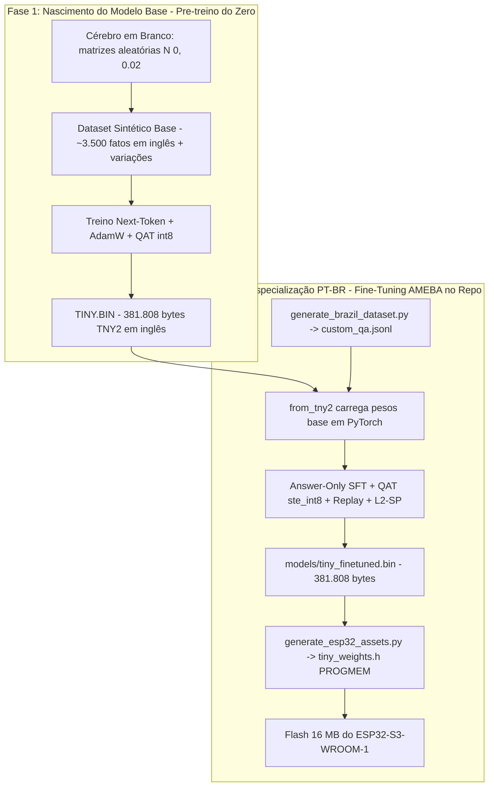
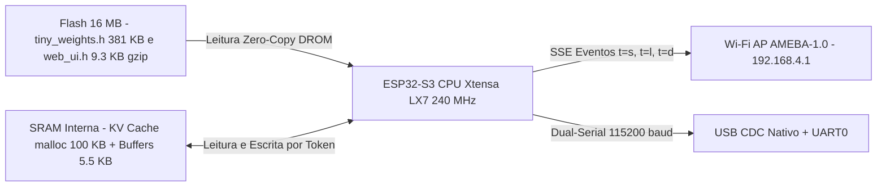

# Módulo 1 — Como Uma LLM Nasce: Do Ruído Aleatório ao Silício do ESP32-S3

> **Carga horária sugerida:** 4 horas  
> **Hardware padrão:** `ESP32-S3-WROOM-1 (16MB)`  
> **Arquivos do repositório explorados:** [`tools/finetune_tiny.py`](../../tools/finetune_tiny.py), [`tools/generate_brazil_dataset.py`](../../tools/generate_brazil_dataset.py), [`tools/txt_to_jsonl.py`](../../tools/txt_to_jsonl.py), [`tools/generate_esp32_assets.py`](../../tools/generate_esp32_assets.py), [`TinyESP32/TinyESP32.ino`](../../TinyESP32/TinyESP32.ino), [`TinyESP32/tiny_engine.h`](../../TinyESP32/tiny_engine.h), [`TinyESP32/tiny_session.cpp`](../../TinyESP32/tiny_session.cpp), [`README.TXT`](../../README.TXT), [`data/custom_qa.txt`](../../data/custom_qa.txt)

---

## Objetivos de Aprendizagem

Ao concluir este módulo, o aluno será capaz de:
1. Destrinchar **como a LLM deste repositório foi criada passo a passo** — da inicialização aleatória ao treino de próximo token, quantização `int8` e empacotamento binário `TNY2`.
2. Calcular e auditar via script de onde vêm os **366.528 parâmetros** e os **381.808 bytes** de [`TINY.BIN`](../../TINY.BIN).
3. Ver na prática, no PC, uma mini-LLM **nascer do zero absoluto** (saindo de lixo aleatório para respostas coerentes em poucos segundos).
4. Gravar e executar o diagnóstico de hardware e o firmware no **`ESP32-S3-WROOM-1 (16MB)`**, distinguir Flash (`PROGMEM`/`DROM`), SRAM e PSRAM, e diagnosticar os limites do modelo *char-level* que motivam os Módulos 2 a 6.

---

## Arquivos Práticos Deste Módulo

Esta pasta contém todos os códigos executáveis e datasets dos laboratórios do Módulo 1 (nenhum deles sobrescreve `TINY.BIN` ou o sketch principal [`TinyESP32/`](../../TinyESP32/)):

| Arquivo na Pasta do Módulo | Tipo | Para Que Serve |
| :--- | :---: | :--- |
| [`lab01_auditoria_tny2.py`](./lab01_auditoria_tny2.py) | Python | Disseca [`TINY.BIN`](../../TINY.BIN) tensor por tensor (`366.528` params, `3.169` escalas, `381.808` B) e exibe o Raio-X da tokenização ASCII + máscara `-100` |
| [`lab02_nascer_do_zero.py`](./lab02_nascer_do_zero.py) | Python | Instancia `TinyTransformer` com pesos aleatórios `N(0, 0.02)`, treina do zero com QAT `int8`, exporta `TNY2` em `out/` e testa generalização |
| [`esp32s3_diagnostico_memoria/esp32s3_diagnostico_memoria.ino`](./esp32s3_diagnostico_memoria/esp32s3_diagnostico_memoria.ino) | Arduino C++ | Audita no seu `ESP32-S3-WROOM-1 (16MB)` o tamanho real da Flash, SRAM interna, PSRAM (`N16`/`N16R2`/`N16R8`), partições e alocação Zero-Copy |
| [`lab03_limites_char.py`](./lab03_limites_char.py) | Python | Faz fine-tuning sobre `TINY.BIN` com o dataset local e imprime o diagnóstico das **3 Dores** do modelo de caracteres |
| [`data/lab01_limites_char.txt`](./data/lab01_limites_char.txt) | Dataset | Casos didáticos criados para provocar truncamento em `CTX=128`, perda de acentuação UTF-8 e quebra de contexto multi-turno |
| [`.gitignore`](./.gitignore) | Config | Mantém `out/` e `__pycache__/` fora do versionamento Git |

---

## 1. A Biografia Técnica Desta LLM: Como Nasceram `TINY.BIN` e `AMEBA`

Antes de plugar o cabo USB, precisamos acabar com o principal mito sobre LLMs: **não existe nenhuma "mágica" dentro de [`TINY.BIN`](../../TINY.BIN) ou [`models/tiny_finetuned.bin`](../../models/tiny_finetuned.bin)**. Um modelo de linguagem treinado é apenas um arquivo binário congelado contendo matrizes de números que foram ajustadas por tentativas e erros até prever bem o próximo caractere.

Neste repositório, essa criação aconteceu em **duas grandes fases**:



### Por que o modelo tem exatamente esse tamanho? (Restrição histórica do DOS)

Olhando [`README.TXT`](../../README.TXT) e [`TINY.C`](../../TINY.C), descobrimos a origem do formato: o projeto original foi criado para rodar em **MS-DOS**, onde um programa em modo *Large* tem cerca de **540 KB de RAM convencional** utilizável.
Para o modelo e seus buffers caberem nesse teto, os autores escolheram uma geometria minúscula de Transformer:
* **`VOCAB = 97`**: apenas padding, separador/EOS e caracteres ASCII imprimíveis.
* **`CTX = 128`**: janela máxima somando pergunta + separador + resposta.
* **`D = 96`**: largura do vetor que representa cada letra dentro da rede.
* **`L = 4`, `H = 4`, `HID = 256`**: 4 camadas Transformer, 4 cabeças de atenção e camada intermediária MLP com 256 neurônios.

### De onde vêm os "367 mil parâmetros" e os `381.808` bytes?

Não há números escondidos. Cada linha da tabela abaixo corresponde diretamente a um atributo da classe `TinyTransformer` em [`tools/finetune_tiny.py`](../../tools/finetune_tiny.py#L131-L151) (e você pode auditá-las no binário real executando [`lab01_auditoria_tny2.py`](./lab01_auditoria_tny2.py)):

| Componente no Código (`TinyTransformer`) | Fórmula / Dimensão | Parâmetros (`weights`) | Escalas `float32` | Bytes no `.bin` (`TNY2`) |
| :--- | :--- | :---: | :---: | :---: |
| **Cabeçalho `"TNY2"`** | `4 B magic + 4 × uint16` | — | — | `12 B` |
| **Embeddings (`emb`)** *(reusado na saída via Weight Tying)* | `97 × 96` | `9.312` | `97` | `97 × (4 + 96) = 9.700 B` |
| **Posições (`pos`)** | `128 × 96` | `12.288` | `128` | `128 × (4 + 96) = 12.800 B` |
| **Ganhos RMSNorm (`g1` + `g2` × 4 camadas)** | `4 × (96 + 96)` | `768` (`float32`) | — | `768 × 4 = 3.072 B` |
| **Atenção (`wq, wk, wv, wo` × 4 camadas)** | `4 × 4 × (96 × 96)` | `147.456` | `1.536` | `1.536 × (4 + 96) = 153.600 B` |
| **MLP (`f1` e `f2` × 4 camadas)** | `4 × (256×96 + 96×256)` | `196.608` | `1.408` | `4 × (256×100 + 96×260) = 202.240 B` |
| **Norma Final (`gf`)** | `96` | `96` (`float32`) | — | `96 × 4 = 384 B` |
| **Total Exato de `TINY.BIN`** | — | **`366.528` parâmetros** | **`3.169` escalas** | **`381.808` bytes** |

> **Perceba a elegância:** Em `float32` puro (4 bytes por número), esses `366.528` pesos ocupariam **`1.466.112` bytes (~1,40 MB)**. Guardando cada peso em **`int8` (1 byte)** junto com uma única escala `float32` por linha (`3.169` escalas = `12.676 B`), o modelo encolhe quase **3,84x** para exatos **`381.808` bytes**!

---

## 2. As 6 Etapas de Criação de uma LLM (Destrinchadas no Código)

Toda LLM — do GPT/Gemini de centenas de bilhões de parâmetros até o TINY de 366 mil — passa exatamente por estas **6 etapas**. A diferença está apenas na escala.

### Etapa 1 — Transformar Texto em Números (Tokenização)

Redes neurais só multiplicam números. Em [`tools/finetune_tiny.py`](../../tools/finetune_tiny.py#L28-L33) e [`TinyESP32/tiny_engine.h`](../../TinyESP32/tiny_engine.h#L11), o vocabulário tem `97` símbolos:
* **`0` (`PAD_TOK`)**: preenchimento de espaço vazio em lotes de treino.
* **`1` (`SEP_TOK` / `EOS`)**: separa o fim da pergunta do início da resposta — e também indica quando a resposta terminou (`eos_tok`).
* **`2..96`**: caracteres ASCII imprimíveis do código `32` (`' '`) até `126` (`'~'`), convertidos pela regra `tok = ord(ch) - 30`.

Veja como um exemplo de treino `"oi" | "ola!"` vira os vetores numéricos `inp` (entrada) e `tgt` (alvo esperado na posição seguinte) em `build_training_sample()` ([`finetune_tiny.py`](../../tools/finetune_tiny.py#L511-L517)):

```text
Posição p:      0      1      2       3      4      5      6
Entrada inp:  'o'    'i'    <SEP>   'o'    'l'    'a'    '!'
Token ID:      81     75      1      81     78     67     3
Alvo tgt:     -100   -100    81      78     67     3      1 (<EOS>)
               ^      ^      ^       ^      ^      ^      ^
            ignora pergunta  |---- aprende só a gerar a resposta ----|
```

### Etapa 2 — O "Cérebro em Branco" (Inicialização Aleatória)

Antes da primeira iteração de treino, um Transformer não sabe nenhuma palavra, nenhum idioma e nenhuma regra gramatical:
* Todas as matrizes de pesos (`emb`, `pos`, `wq`, `wk`, `wv`, `wo`, `f1`, `f2`) começam preenchidas com **ruído gaussiano pequeno** em torno de zero, tipicamente `N(0, 0.02)` (média `0`, desvio-padrão `0,02`).
* Os vetores de ganho de normalização (`g1`, `g2`, `gf`) começam em **`1.0`**.
* **Importante no código do repo:** em [`finetune_tiny.py`](../../tools/finetune_tiny.py#L140-L150), `TinyTransformer.__init__` usa `torch.empty(...)` apenas porque `from_tny2()` logo preenche os tensores com os pesos já treinados de `TINY.BIN`. Quando criamos um modelo **do zero absoluto** (implementado em `initialize_blank_brain()` dentro de [`lab02_nascer_do_zero.py`](./lab02_nascer_do_zero.py)), preenchemos todas as matrizes 2D com `torch.nn.init.normal_(p, mean=0.0, std=0.02)`.

Com pesos aleatórios, os logits de saída para qualquer pergunta dão aproximadamente `1/97` (~1% de chance) para cada caractere. Se você rodar a inferência agora, sairá apenas lixo caótico.

### Etapa 3 — A Engenharia do Dataset (Como Nasceu a Inteligência do Modelo)

Um modelo de 366 mil parâmetros não consegue aprender gramática e fatos lendo páginas aleatórias e sujas da internet. Como mostra o arquivo [`README.TXT`](../../README.TXT#L104-L118), o salto do `TINY` da **versão 1 (6% de acerto)** para a **versão 2.1 (90% em perguntas no estilo de treino e 61% em 780 perguntas inéditas)** veio de um **gerador programático de dados sintéticos** cobrindo ~3.500 fatos com múltiplas formulações, saudações, erros leves de digitação e caixa alta/baixa.

Neste repositório, vemos exatamente essa técnica implementada em português por [`tools/generate_brazil_dataset.py`](../../tools/generate_brazil_dataset.py) e [`tools/txt_to_jsonl.py`](../../tools/txt_to_jsonl.py), que geram [`data/custom_qa.txt`](../../data/custom_qa.txt) e [`data/custom_qa.jsonl`](../../data/custom_qa.jsonl):
* Agrupam diversas maneiras de fazer a mesma pergunta (`"qual a capital do acre?" ; "capital do acre" ; "qual a capital de ac?" | "A capital do Acre (AC) é Rio Branco."`);
* Incluem **exemplos de recusa segura** (`"qual a cotacao do dolar hoje?" | "Não sei responder isso; sou o AMEBA offline..."`);
* Aplicam variações automáticas (`augment_pairs`) e ruído tipográfico (`perturb_question` com `--char-noise 0.10`) durante o treino para o modelo tolerar erros de digitação no celular.

### Etapa 4 — O Motor de Aprendizado (`Forward Causal`, `Cross-Entropy` e `AdamW`)

Como a rede sai do ruído aleatório e aprende a prever `"o-l-a-!"`? Em cada lote (*batch*) do loop de treino em [`finetune_tiny.py`](../../tools/finetune_tiny.py#L747-L769):

1. **Predição Paralela com Máscara Causal (`causal_mask`):**
   Ao contrário do ESP32 (que gera uma letra por vez), durante o treino na GPU/CPU a frase inteira entra de uma vez só. A máscara triangular superior (`torch.triu(..., diagonal=1)`) impede que a posição `p` espie as posições `p+1, p+2...`. Assim, o computador calcula as previsões de todas as letras da resposta em um único passo!
2. **Foco Total na Resposta (`Answer-Only SFT` com `ignore_index=-100`):**
   Quando passamos `ignore_index=-100` para `F.cross_entropy`, a função de perda **ignora o erro nos tokens da pergunta**. Os 366.528 pesos não desperdiçam memória tentando adivinhar o que o usuário vai perguntar — toda a capacidade neural vai para acertar a resposta e o token de parada `<EOS>`.
3. **Medindo o Erro (`Cross-Entropy Loss`):**
   Para cada posição da resposta, aplicamos Softmax para obter a probabilidade `p_certa` que a rede deu para o caractere verdadeiro. A perda naquela posição é `-ln(p_certa)`:
   * No início (chute uniforme `1/97`): `-ln(1/97) ≈ 4,57`.
   * Quando o modelo já acerta quase com certeza (`p_certa ≈ 0,95`): `-ln(0,95) ≈ 0,05`.
4. **Backpropagation e Otimizador (`loss.backward()` + `AdamW`):**
   O PyTorch calcula pela regra da cadeia quanto cada um dos 366.528 pesos contribuiu para o erro (*gradiente*), corta gradientes explosivos (`clip_grad_norm_(..., 1.0)`) e o otimizador **`AdamW`** ajusta cada peso um pequeno passo na direção que reduz a perda, usando aquecimento inicial (*warmup*) e decaimento em cosseno da taxa de aprendizado (`lr`).

### Etapa 5 — Domando os 8 Bits no Treino (`QAT` + Anti-Esquecimento)

Se treinarmos normalmente em `float32` e só arredondarmos para `int8` no final (*PTQ - Post-Training Quantization*), redes minúsculas costumam "ficar burras" porque pequenas mudanças nos pesos somam erros acumulados nas 4 camadas.

Por isso [`finetune_tiny.py`](../../tools/finetune_tiny.py#L119-L123) usa **QAT (*Quantization-Aware Training*)**:
* A função `ste_int8(x)` quantiza e desquantiza pesos e vetores `K`/`V` durante o *forward* (simulando a aritmética exata do ESP32), mas usa `.detach()` para que no *backward* o gradiente flua sem travar no arredondamento (*Straight-Through Estimator*).
* Além disso, no ajuste fino do `AMEBA` sobre o `TINY.BIN`, usam-se **L2-SP** (penaliza pesos que se afastam demais dos valores originais) e **Replay Autodestilado** (`ANCHOR_QUESTIONS`: o próprio modelo base gera 30 respostas-âncora e as mistura nas épocas de treino) para ensinar português sem apagar o que ele já sabia!

### Etapa 6 — Congelamento e Transplante para o Silício (`TNY2` → `PROGMEM`)

Depois do treino, os gradientes e o otimizador são descartados. Só sobra o arquivo estático:
1. `model.export_tny2()` quantiza cada linha de cada tabela (`scale = max(|row|) / 127.0`, `w_int8 = round(row / scale)`), empacota com o cabeçalho `"TNY2"` e salva o `.bin` de `381.808` bytes.
2. [`tools/generate_esp32_assets.py`](../../tools/generate_esp32_assets.py) lê esse `.bin` e gera [`TinyESP32/tiny_weights.h`](../../TinyESP32/tiny_weights.h) como um array constante `TINY_BIN_U32[95452] PROGMEM`.
3. No ESP32-S3, o modelo nunca mais treina — ele só executa **inferência** (*forward* puro passo a passo), lendo os pesos direto da Flash.

> **Resumo definitivo:** **Treino** = descobrir os `366.528` números no PC via `Cross-Entropy + AdamW`. **Inferência** = congelar esses números em `381.808` bytes na Flash do ESP32-S3 e multiplicá-los em sequência para gerar texto.

---

## 3. Laboratório Prático 1 (No PC) — Auditoria e Nascimento do Zero

### Parte A: Auditar [`TINY.BIN`](../../TINY.BIN) e o Raio-X de Tokens
Execute [`lab01_auditoria_tny2.py`](./lab01_auditoria_tny2.py) a partir da raiz do repositório:

```bash
python curso/modulo-01-hello-neural-silicon/lab01_auditoria_tny2.py
```

O script percorre o arquivo binário real, verifica todos os offsets e escalas (`366.528` parâmetros, `3.169` escalas `float32`, `381.808` bytes) e imprime a tabela passo a passo de `inp` e `tgt` (mostrando onde entra `-100` e onde entra `<SEP/EOS>`). Você também pode testar com outras frases:

```bash
python curso/modulo-01-hello-neural-silicon/lab01_auditoria_tny2.py --question "qual sua placa?" --answer "esp32-s3!"
```

### Parte B: Ver uma LLM Nascer do Zero Absoluto
Agora execute [`lab02_nascer_do_zero.py`](./lab02_nascer_do_zero.py) — ele **não carrega `TINY.BIN`**: cria um `TinyTransformer` com ruído gaussiano `N(0, 0.02)`, mostra o lixo aleatório antes do treino, treina `180` passos com `qat=True` e exporta para `out/lab02_depois_do_treino.bin`:

```bash
python curso/modulo-01-hello-neural-silicon/lab02_nascer_do_zero.py
```

### O que observar na saída desse experimento?
1. **`[ANTES DO TREINO]`:** Com loss inicial perto de `4,57` (`ln(97)`), o modelo quantizado em `int8` gera uma sequência caótica sem sentido.
2. **`Passo 1 → 180`:** Veja a *Cross-Entropy Loss* cair de `~4,57` para perto de `0,0015` enquanto a rede descobre espaços, pontuação, sílabas e as 4 frases completas já quantizadas em `int8`!
3. **`[TESTE INÉDITO]`:** Ao perguntar `"qual seu nome?"` (que nunca esteve nos 4 exemplos), o modelo tropeça ou mistura fragmentos das 4 respostas conhecidas. **Essa é a prova prática da diferença entre Pré-treino e Fine-Tuning:** para generalizar perguntas inéditas, uma LLM precisa de **milhares de exemplos variados** no pré-treino (como foi feito para criar `TINY.BIN`).

*(Dica: rode também com `--no-qat` para comparar quantização pós-treino vs QAT, ou com `--generate-header` para gerar `out/tiny_weights_do_zero.h`.)*

---

## 4. Laboratório Prático 2 — Hardware e Firmware no `ESP32-S3-WROOM-1 (16MB)`

Agora vamos verificar o silício real da sua placa e subir o modelo completo no **ESP32-S3-WROOM-1 (16MB)**.



### Memórias envolvidas no ESP32-S3

| Memória no ESP32-S3-WROOM-1 (16MB) | Velocidade Relativa | Volátil? | Uso no Firmware Atual (`TNY2`) | Limite Prático |
| :--- | :---: | :---: | :--- | :--- |
| **Flash SPI (16 MB)** | Mais lenta (usa cache L1 I/D) | Não | Código do firmware + `TINY_BIN_U32` (`381.808` bytes) + `INDEX_HTML_GZ` | No layout padrão [`partitions.csv`](../../TinyESP32/partitions.csv), `app0` tem `1.920 KB` (`0x1E0000`) |
| **SRAM Interna (512 KB)** | Muito rápida | Sim | Pilha Wi-Fi/TCP, variáveis globais e **KV Cache** (`kc`, `vc`, `ks`, `vs` = `102.400` bytes) | ~300–350 KB livres após boot; não cabe copiar os pesos para cá junto com Wi-Fi |
| **PSRAM (`0 MB` na `N16`, `2 MB` na `N16R2`, `8 MB` na `N16R8`)** | Intermediária (SPI/OPI) | Sim | Fallback automático em `tiny_alloc_kv()` quando `ESP.getFreeHeap() < 180000u && psramFound()` | Ideal para janelas de contexto longas, não obrigatória no `TNY2` |

> **Observação importante:** No ESP32-S3, o qualificador `PROGMEM` em [`tiny_weights.h`](../../TinyESP32/tiny_weights.h) posiciona os `381.808` bytes na seção **DROM**, mapeada pela MMU direto no espaço de endereçamento da CPU. Resultado: **0 bytes de RAM consumidos pelos pesos**.

### Passo 1: Diagnóstico de Memória com o Sketch do Módulo 1
Antes do modelo completo, abra e grave [`esp32s3_diagnostico_memoria.ino`](./esp32s3_diagnostico_memoria/esp32s3_diagnostico_memoria.ino) na Arduino IDE com as configurações abaixo em **Tools**:
1. **Board:** `ESP32S3 Dev Module`
2. **USB CDC On Boot:** `Enabled` *(essencial para o `Serial` funcionar no cabo USB nativo)*
3. **USB Mode:** `Hardware CDC and JTAG`
4. **Flash Size:** `16MB (128Mb)`
5. **Flash Mode:** `QIO 80MHz` *(se houver erro de boot no Serial, mude para `DIO`)*
6. **PSRAM:** `OPI PSRAM` (`N16R8`), `QSPI PSRAM` (`N16R2`) ou `Disabled` (`N16` sem PSRAM)

Abra o Serial Monitor (`115200 baud`) e confira:
* Se a Flash aparece como **16 MB** (e a tabela de partições atual);
* Quantos KB de **SRAM Interna** livres restam e se sua placa tem PSRAM (`N16` vs `N16R2` vs `N16R8`);
* Na seção `[5] Demonstração Zero-Copy`, comprove que `PROGMEM` consome **`0 B` de RAM**, enquanto `malloc(102400)` reduz o heap interno em `~100 KB`.

### Passo 2: Validar e gravar o firmware completo [`TinyESP32/TinyESP32.ino`](../../TinyESP32/TinyESP32.ino)
1. No PC, valide a integridade do porte:
   ```bash
   python tools/verify_port.py
   ```
2. Na Arduino IDE, abra [`TinyESP32/TinyESP32.ino`](../../TinyESP32/TinyESP32.ino), mantenha as mesmas configurações de **Tools** (com **Partition Scheme:** `Huge APP (3MB No OTA/1MB SPIFFS)` ou o [`partitions.csv`](../../TinyESP32/partitions.csv) local) e clique em **Upload**. Aguarde **2 a 4 segundos** após o reset para a porta USB CDC reenumerar.

### Passo 3: Testar via Serial Monitor e via Wi-Fi (Captive Portal)

1. **No Serial Monitor (`115200 baud`):**
   * Digite `/status` e confirme: `4 layers, 96 wide, 4 heads, HID 256`, `Flash pesos: 381808 bytes`, `RAM motor` (~108 KB) e `Heap livre`.
   * Digite `/demo` e experimente `/0` (determinístico) versus `/9` (criatividade máxima).
2. **Na Interface Web Neon (Celular ou Notebook):**
   * Conecte-se ao Access Point **`AMEBA-1.0`** *(definido em `AP_SSID` em [`TinyESP32.ino`](../../TinyESP32/TinyESP32.ino))*.
   * Acesse **`http://192.168.4.1`** e observe o **`NEURAL MONITOR`**:
     * **`LAYER ACTIVITY`**: média das ativações ReLU de cada uma das 4 camadas (eventos SSE `t: "s"` e `t: "l"`).
     * **`CONFIDENCE`**: probabilidade `last_conf` da letra escolhida.
     * **`SPEED`**: throughput real em `letters/s` no ESP32-S3.

---

## 5. Laboratório Prático 3 — Provocando os Limites do Modelo de Letras

Agora executamos [`lab03_limites_char.py`](./lab03_limites_char.py) usando [`data/lab01_limites_char.txt`](./data/lab01_limites_char.txt) para fazer fine-tuning sobre `TINY.BIN` e gerar um relatório automático expondo por que precisamos evoluir além do modelo *char-level*:

```bash
python curso/modulo-01-hello-neural-silicon/lab03_limites_char.py
```

*(Passe `--chat` ao final se quiser conversar interativamente com `out/lab03_limites.bin` no terminal.)*

### As 3 Dores Estruturais que o Script Vai Expor

1. **Dor 1 — Amputação de Contexto (`MAXQ = 72`, `CTX = 128`):**
   Como cada caractere consome 1 posição da janela `CTX = 128` ([`tiny_engine.h`](../../TinyESP32/tiny_engine.h#L11-L16)), a primeira resposta de [`data/lab01_limites_char.txt`](./data/lab01_limites_char.txt) **é cortada antes de terminar**! Não sobra espaço para múltiplos turnos nem leituras de sensores.
2. **Dor 2 — Desperdício de Capacidade com Ortografia e Perda de Acentos:**
   Os `366.528` parâmetros precisam aprender até como soletrar palavras sílaba por sílaba (`v-e-n-t-i-l-a-d-o-r`), tropeçando quando trocamos sinônimos (`"bota o ventilador da bancada pra girar"`). Além disso, `tiny_clean_question()` ([`tiny_engine.cpp`](../../TinyESP32/tiny_engine.cpp#L399-L432)) precisa arrancar todos os acentos (`ç -> c`, `ã -> a`, `é -> e`).
3. **Dor 3 — Muleta em C Puro (`929` linhas de regras manuais):**
   Abra [`TinyESP32/tiny_session.cpp`](../../TinyESP32/tiny_session.cpp#L53-L177) (`FOLLOWUP_RULES[]`, `detect_topic()`): o firmware precisou de quase mil linhas manuais em C para simular memória de conversa porque a janela de 128 caracteres não comporta diálogo real na atenção.

---

## 6. Exercícios e Desafio do Módulo

1. **Auditoria do Modelo Fine-Tuned:** Rode [`lab01_auditoria_tny2.py`](./lab01_auditoria_tny2.py) apontando para o modelo brasileiro já ajustado:
   ```bash
   python curso/modulo-01-hello-neural-silicon/lab01_auditoria_tny2.py --bin models/tiny_finetuned.bin
   ```
   Compare os intervalos de escalas (`[min, max]`) entre `TINY.BIN` e `models/tiny_finetuned.bin`. O número total de parâmetros (`366.528`) mudou?
2. **Experimento de Capacidade do Zero (`4` vs `16` pares):** Rode [`lab02_nascer_do_zero.py`](./lab02_nascer_do_zero.py) aumentando o dataset para 16 pares mantendo 180 passos:
   ```bash
   python curso/modulo-01-hello-neural-silicon/lab02_nascer_do_zero.py --dataset-size 16 --steps 180
   ```
   Compare a `Loss` final e a taxa de acerto com `--dataset-size 4`. Em quantos `--steps` ele volta a acertar `16/16`? E o que acontece se você desligar o QAT com `--no-qat`?
3. **Leitura de Hardware e Temperatura:** No ESP32-S3 via Serial, compare os valores de `Heap livre` reportados pelo [`esp32s3_diagnostico_memoria.ino`](./esp32s3_diagnostico_memoria/esp32s3_diagnostico_memoria.ino) (sem Wi-Fi) vs `/status` do [`TinyESP32.ino`](../../TinyESP32/TinyESP32.ino) (com Wi-Fi + Captive Portal ativos). Depois teste uma mesma pergunta com `/0`, `/4` e `/9`, observando a variação de `CONFIDENCE` no *Neural Monitor*.

---

| Anterior | Índice | Próximo |
| :--- | :---: | :--- |
| — | [Guia do Curso](../README.md) | [Módulo 2: Anatomia do Transformer em C Puro →](../modulo-02-anatomia-transformer-c/README.md) |
