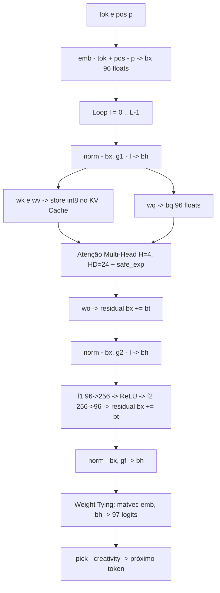

# Módulo 2 — Anatomia do Transformer em C Puro e PyTorch

> **Carga horária sugerida:** 4 horas  
> **Hardware padrão:** `ESP32-S3-WROOM-1 (16MB)`  
> **Arquivos do repositório analisados:** [`TinyESP32/tiny_engine.cpp`](../../TinyESP32/tiny_engine.cpp), [`TinyESP32/tiny_engine.h`](../../TinyESP32/tiny_engine.h), [`tools/finetune_tiny.py`](../../tools/finetune_tiny.py), [`tools/generate_esp32_assets.py`](../../tools/generate_esp32_assets.py), [`tools/verify_port.py`](../../tools/verify_port.py)

---

## Objetivos de Aprendizagem

Ao concluir este módulo, o aluno será capaz de:
1. Mapear **linha por linha** um Transformer em PyTorch para sua implementação exata em C sem frameworks.
2. Explicar o layout binário `TNY2` em memória e por que **alinhamento de 4 bytes** e **FPU `float32`** definem a performance e a segurança em microcontroladores.
3. Compreender como o **KV Cache quantizado em `int8`** economiza ~3,8x de RAM sem destruir a qualidade do modelo.
4. Instrumentar o firmware no ESP32-S3 com `esp_timer_get_time()` para descobrir exatamente qual operação consome mais tempo por token.

---

## Arquivos Práticos Deste Módulo

| Arquivo na Pasta do Módulo | Tipo | Para Que Serve |
| :--- | :---: | :--- |
| [`lab01_espelho_pytorch_vs_c.py`](./lab01_espelho_pytorch_vs_c.py) | Python | Compara estágio por estágio PyTorch (`TinyTransformer`) vs C (`ZeroCopyModel`) em [`TINY.BIN`](../../TINY.BIN) e calcula a fração de MACs em `matvec()` |
| [`lab02_kv_cache_e_qat.py`](./lab02_kv_cache_e_qat.py) | Python | Demonstra fidelidade do KV Cache `int8` (SNR/cosseno), estabilidade do Softmax (`safe_exp`) e comparativo QAT vs PTQ |
| [`esp32s3_profiling_step/esp32s3_profiling_step.ino`](./esp32s3_profiling_step/esp32s3_profiling_step.ino) | Arduino C++ | Mede no `ESP32-S3-WROOM-1 (16MB)` quantos microssegundos cada bloco de `step()` consome e compara `float32` vs `double` |
| [`.gitignore`](./.gitignore) | Config | Ignora `out/` e `__pycache__/` |

---

## 1. Um Único Desenho, Duas Linguagens: PyTorch ↔ C

Um dos maiores trunfos deste repositório é que [`tools/finetune_tiny.py`](../../tools/finetune_tiny.py) e [`TinyESP32/tiny_engine.cpp`](../../TinyESP32/tiny_engine.cpp) implementam **matematicamente o mesmo grafo** (há até um simulador idêntico em `QuantizedTny2Runner` e `ZeroCopyModel` em [`tools/verify_port.py`](../../tools/verify_port.py#L180-L327)).



### Tabela de Espelhamento PyTorch ↔ C Puro

| Etapa Matemática | Em PyTorch ([`finetune_tiny.py`](../../tools/finetune_tiny.py)) | Em C Embarcado ([`tiny_engine.cpp`](../../TinyESP32/tiny_engine.cpp)) | Por que é feito assim? |
| :--- | :--- | :--- | :--- |
| **Token + Posição** | `F.embedding(tokens, emb_w) + pos_w.unsqueeze(0)` | `bx[i] = (float)e[i] * es + (float)q[i] * ps` | Soma vetorial direta desquantizando cada `int8` pela escala `float32` da linha |
| **RMSNorm** | `x * torch.rsqrt(x.pow(2).mean(-1, keepdim=True) + 1e-5) * g` | `norm(bx, g1[l], bh)` com `1.0f / sqrtf(s / (float)D + 1e-5f)` | Evita subtrair média (como LayerNorm) e economiza operações/parâmetros sem bias |
| **Produto Matriz-Vetor** | `F.linear(h, wq)` | `matvec(&wq[l], bh, bq)` com unrolling 4x (`s0..s3`) | Na geração autorregressiva (1 token por vez), não há `matmul` com batch: tudo vira `matvec` |
| **Quantização KV** | `ste_int8(k)` e `ste_int8(v)` durante QAT | `store(kc[l] + p*D, bt)` retornando `big / 127.0f` | Cada vetor `K` e `V` vira `D` bytes (`int8`) + 4 bytes de escala (`float`) |
| **Softmax Estável** | `F.softmax(att, dim=-1)` | `bs[j] = safe_exp(bs[j] - big)` onde `x < -60.0f -> 0.0f` | Subtrair o máximo `big` impede *overflow* de `expf()` e economiza chamadas caras de exponencial |
| **Feed-Forward (MLP)** | `F.linear(F.relu(F.linear(h2, f1)), f2)` | `matvec(&f1)` → ReLU + `layer_act[l]` → `matvec(&f2)` | Expande de `D=96` para `HID=256` e projeta de volta; registra média de ativação para a UI |
| **Cabeça de Saída** | `F.linear(hf, emb_w)` *(Weight Tying)* | `matvec(&emb, bh, out_score)` | Reutiliza a matriz `emb` (`97 × 96`) na saída, economizando espaço na Flash |
| **Amostragem** | `QuantizedTny2Runner.ask()` | `pick(creativity)` | Se `creativity == 0`: argmax; senão aplica `t = creativity / 5.0f` e zera probs `< 0.22f` |

---

## 2. Dissecação do Formato Binário `TNY2` e Execução Zero-Copy

Abra [`tools/generate_esp32_assets.py`](../../tools/generate_esp32_assets.py#L19-L64) para ver o contrato binário que une o treino em Python e o motor em C:

```text
Offset 0..11   (12 B):  "TNY2" | u16 D=96 | u16 L=4 | u16 H=4 | u16 HID=256
Offset 12..    (emb):   97 linhas  × [float32 scale (4 B) + 96 × int8 (96 B)] = 9.700 B
               (pos):   128 linhas × [float32 scale (4 B) + 96 × int8 (96 B)] = 12.800 B
Para cada camada l = 0..3:
               g1[l]:   96 × float32 = 384 B
               wq,wk,wv,wo[l]: 4 × (96 linhas × 100 B) = 38.400 B
               g2[l]:   384 B
               f1[l]:   256 linhas × (4 + 96) B = 25.600 B
               f2[l]:   96 linhas  × (4 + 256) B = 24.960 B
Final:         gf:      96 × float32 = 384 B
------------------------------------------------------------------------------
Total exato: 381.808 bytes (todos os registros alinhados em múltiplos de 4 bytes!)
```

### Três truques de C embarcado presentes em [`tiny_engine.cpp`](../../TinyESP32/tiny_engine.cpp)

1. **Leitura Segura e Alinhada (`read_f32`):**
   Em arquiteturas RISC/Xtensa, converter um `const uint8_t *` arbitrário diretamente em `*(const float *)p` pode violar *strict aliasing* ou causar exceção de alinhamento se não for múltiplo de 4. O motor garante o alinhamento no gerador (`uint32_t TINY_BIN_U32[] PROGMEM`) e usa `memcpy(&v, __builtin_assume_aligned(p, 4), sizeof(float))` — compilando em uma instrução única de carga na Flash (`l32i` / load de 32 bits) sem risco de UB (*Undefined Behavior*).

2. **FPU estritamente `float32` (Verificada por CI local):**
   O Xtensa LX7 do ESP32-S3 possui FPU em hardware apenas para **precisão simples (`float`)**. Se você escrever `sqrt()` em vez de `sqrtf()`, ou `0.5` em vez de `0.5f`, o compilador injeta rotinas de emulação por software para `double` (64 bits), derrubando a velocidade em mais de 10x. Por isso [`tools/verify_port.py`](../../tools/verify_port.py#L134-L140) proíbe estaticamente `double`, `sqrt(`, `exp(`, `log(` e `pow(`.

3. **Desenrolamento de Laço 4x em `matvec()`:**
   ```c
   for (; c + 3 < cols; c += 4) {
       s0 += (float)w[c]     * x[c];
       s1 += (float)w[c + 1] * x[c + 1];
       s2 += (float)w[c + 2] * x[c + 2];
       s3 += (float)w[c + 3] * x[c + 3];
   }
   float s = (s0 + s1) + (s2 + s3);
   ```
   Sem quatro acumuladores independentes (`s0..s3`), cada iteração teria que esperar o resultado da soma anterior antes de iniciar a próxima multiplicação-acumulação (`madd.s`). Quebrar essa dependência de dados enche o pipeline da FPU!

---

## 3. A Economia do KV Cache em `int8`

Durante a geração, não recalculamos `K` e `V` dos tokens passados: guardamos esses vetores em memória (**KV Cache**).
* Em `float32` puro (`4 bytes` por elemento):
  `4 camadas × 128 posições × 96 dimensões × 2 (K e V) × 4 B = 393.216 bytes` (**~384 KB** — estouraria a SRAM utilizável ao lado do Wi-Fi!).
* Com quantização dinâmica por vetor na função `store()`:
  `4 camadas × 128 posições × (96 bytes int8 + 4 bytes scale) × 2 = 102.400 bytes` (**100 KB exatos** — redução de **3,84x**!).

E como essa perda de precisão não estraga as respostas? Porque o treino em [`finetune_tiny.py`](../../tools/finetune_tiny.py#L119-L123) usa **QAT com `ste_int8`** (*Straight-Through Estimator*): no *forward* ele simula o arredondamento `int8`; no *backward* o gradiente passa reto como se o arredondamento fosse identidade, ensinando os pesos a conviver com a grade de 8 bits!

---

## 4. Laboratórios Práticos — Espelhamento e Profiling

### Lab 1 (PC): Conferindo a Paridade PyTorch ↔ C e Contando MACs
Execute [`lab01_espelho_pytorch_vs_c.py`](./lab01_espelho_pytorch_vs_c.py):

```bash
python curso/modulo-02-anatomia-transformer-c/lab01_espelho_pytorch_vs_c.py
```

O script verifica que todos os vetores intermediários (`emb+pos`, `RMSNorm`, `after_att`, `after_ffn`, `logits`) batem com similaridade `> 0,999` entre PyTorch e o simulador C, e mostra que **`matvec()` concentra mais de 95% dos cálculos**.

### Lab 2 (PC): Fidelidade do KV Cache, `safe_exp` e QAT vs PTQ
Execute [`lab02_kv_cache_e_qat.py`](./lab02_kv_cache_e_qat.py):

```bash
python curso/modulo-02-anatomia-transformer-c/lab02_kv_cache_e_qat.py
```

### Lab 3 (Hardware): Profiling em Microssegundos no ESP32-S3
Abra e grave [`esp32s3_profiling_step.ino`](./esp32s3_profiling_step/esp32s3_profiling_step.ino) no `ESP32-S3-WROOM-1 (16MB)` e abra o Serial Monitor (`115200 baud`). O sketch usa `esp_timer_get_time()` para imprimir:
* O tempo exato em microssegundos gasto em `QKV/Wo`, `FFN`, `Head`, `Atenção KV` e `RMSNorm`;
* A comparação real de latência entre `matvec_unroll4_f32` (FPU em hardware) e `matvec_double_naive` (emulação por software).

### O que você vai descobrir na prática

* O custo de `RMSNorm`, `ReLU` e `safe_exp` somados é **marginal** (< 5% do tempo).
* Mais de **85% a 90% dos ciclos** no chip estão concentrados dentro de **`matvec()`** — preparando o terreno para:
  1. **Reduzir quantas vezes chamamos `step()` por frase** → Tokenizador BPE (Módulo 3).
  2. **Acelerar `matvec()` usando instruções SIMD `int8`/`int16` do ESP32-S3** → Extensão PIE e Dual-Core (Módulo 6).

---

## 5. Exercícios do Módulo

1. **Conta na Ponta do Lápis:** Calcule o tamanho em bytes na Flash para uma tabela hipotética de `VOCAB = 4.096` linhas e `D = 256` colunas no formato `TNY2` (`4 + cols` por linha). Quanto isso ocuparia em `int8`?
2. **Estabilidade do Softmax:** No bloco `safe_exp` ([`tiny_engine.cpp`](../../TinyESP32/tiny_engine.cpp#L254-L258)), por que usamos o corte `x < -60.0f`? Confira no output do [`lab02_kv_cache_e_qat.py`](./lab02_kv_cache_e_qat.py) quanto vale `exp(-60)` em notação científica.
3. **Experimento QAT vs PTQ:** Modifique o número de passos ou `lr` em [`lab02_kv_cache_e_qat.py`](./lab02_kv_cache_e_qat.py) (ou rode [`tools/finetune_tiny.py`](../../tools/finetune_tiny.py) com e sem `--no-qat`) e compare a acurácia após exportar para `int8`.

---

| Anterior | Índice | Próximo |
| :--- | :---: | :--- |
| [← Módulo 1: Como Uma LLM Nasce](../modulo-01-hello-neural-silicon/README.md) | [Guia do Curso](../README.md) | [Módulo 3: Tokenizador BPE Embarcado →](../modulo-03-tokenizador-bpe-embarcado/README.md) |
