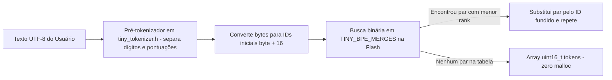

# Módulo 3 — De Letras para Ideias: Tokenizador BPE Embarcado em Português

> **Carga horária sugerida:** 4 horas  
> **Hardware padrão:** `ESP32-S3-WROOM-1 (16MB)`  
> **Arquivos de referência do repo:** [`TinyESP32/tiny_engine.cpp`](../../TinyESP32/tiny_engine.cpp) (`tiny_clean_question`), [`tools/generate_brazil_dataset.py`](../../tools/generate_brazil_dataset.py), [`data/custom_qa.txt`](../../data/custom_qa.txt)

---

## Objetivos de Aprendizagem

Ao concluir este módulo, o aluno será capaz de:
1. Explicar a diferença entre tokenização por **caracteres**, por **palavras inteiras** e por **subpalavras (BPE - Byte-Pair Encoding)**.
2. Calcular o *trade-off* matemático entre tamanho do vocabulário (`V`), tamanho da tabela de embeddings na Flash (`V × D`) e compressão de sequência no ESP32-S3 (16MB).
3. Treinar um tokenizador BPE compacto em **português com acentuação UTF-8 preservada** (`VOCAB = 4.096`).
4. Implementar a codificação e decodificação em C sem alocação dinâmica pesada e validar a paridade exata **Python == C**.

---

## Arquivos Práticos Deste Módulo

| Arquivo na Pasta do Módulo | Tipo | Para Que Serve |
| :--- | :---: | :--- |
| [`bpe_tokenizer.py`](./bpe_tokenizer.py) | Python | Biblioteca reutilizável `TinyBPETokenizer` (Byte-Level BPE, pré-tokenização determinística, exportação binária `TNYV` e header C `PROGMEM`) |
| [`data/corpus_ptbr_dominio.txt`](./data/corpus_ptbr_dominio.txt) | Corpus | Frases em português acentuado (automação IoT + defesa civil + tags `<|ctx|>`, `<|act|>`) para treinar o BPE |
| [`lab03_paridade_bpe.py`](./lab03_paridade_bpe.py) | Python | Treina o BPE (`VOCAB = 4.096`), gera `out/tiny_vocab.bin` e `out/tiny_vocab.h` e valida paridade bit-a-bit Python == C em 55 frases |
| [`esp32s3_bpe_demo/tiny_tokenizer.h`](./esp32s3_bpe_demo/tiny_tokenizer.h) | C Header | Codificador BPE sem `malloc()`, busca binária em `TINY_BPE_MERGES[]` e buffer `TinyUtf8Stream` para SSE |
| [`esp32s3_bpe_demo/tiny_vocab_sample.h`](./esp32s3_bpe_demo/tiny_vocab_sample.h) | C Header | Tabela demonstrativa ordenada para compilar o sketch imediatamente na Arduino IDE |
| [`esp32s3_bpe_demo/esp32s3_bpe_demo.ino`](./esp32s3_bpe_demo/esp32s3_bpe_demo.ino) | Arduino C++ | Sketch interativo no `ESP32-S3-WROOM-1` medindo latência de tokenização UTF-8 em microssegundos |
| [`.gitignore`](./.gitignore) | Config | Ignora `out/` e `__pycache__/` |

---

## 1. O Problema da Tokenização em Microcontroladores

Por que não usar o mesmo tokenizador de modelos gigantes (como 32.000, 50.257 ou 128.000 tokens)?

Faça a conta para uma rede enxuta de `D = 256` em `int8`:
* Se `VOCAB = 128.000` (como Llama 3): a tabela de embeddings sozinha ocuparia `128.000 × (4 + 256) = 33,28 MB` — **mais que o dobro de toda a Flash do ESP32-S3 (16 MB)**!
* Se `VOCAB = 97` (o `TNY2` atual): ocupa só `25 KB`, mas desperdiça context length e capacidade da rede soletrando letra por letra.
* Se `VOCAB = 4.096` (subpalavras BPE treinadas em PT-BR + domínio): ocupa **`4.096 × (4 + 256) = 1.064.960` bytes (~1,01 MB na Flash)**, cabendo com enorme folga nos 16 MB do ESP32-S3!

### Comparação Direta na Prática

Veja quantos passos (`step()`) o ESP32-S3 precisa executar para processar e responder a mesma frase:

| Estratégia | Frase: `"A temperatura da sala está 29°C; ligar ventilação?"` | Nº de Tokens (`step()`) | Preserva Acentos UTF-8? |
| :--- | :--- | :---: | :---: |
| **`TNY2` Char ASCII (`97`)** | `a`,` `,`t`,`e`,`m`,`p`,... (53 chars, sem acento e sem `°`) | **53 tokens** | Não (`tiny_clean_question` achata para ASCII) |
| **BPE Genérico Inglês (`32k`)** | `"A"`, `" temp"`, `"er"`, `"atura"`, `" da"`, `" sal"`, `"a"`, `" est"`, `"á"`... | ~18–22 tokens | Parcial (quebra sílabas PT-BR) |
| **BPE Domínio PT-BR (`4.096`)** | `"A"`, `" temperatura"`, `" da"`, `" sala"`, `" está"`, `" 29"`, `"°C"`, `";"`, `" ligar"`, `" ventilação"`, `"?"` | **~11–14 tokens** | **Sim, nativamente!** |

> **Ganho duplo no ESP32-S3:** Com ~3,5x a 4,5x menos tokens por frase, uma janela `CTX = 256` passa a comportar o equivalente a **~950 caracteres**, e o tempo percebido para gerar uma resposta inteira cai na mesma proporção!

---

## 2. Como Funciona o BPE (Byte-Pair Encoding) em Nível de Bytes

Para que o ESP32-S3 nunca trave com um caractere desconhecido (`<unk>`) — como emojis, `°`, `ç`, `ã` ou acentos agudos — usamos **Byte-Level BPE** implementado em [`bpe_tokenizer.py`](./bpe_tokenizer.py):

1. **Tokens Especiais de Controle (`0..15`):** Reservamos IDs fixos para estruturar prompts, sensores, chamadas de ação e fim de texto.
2. **Base fixa de 256 tokens de byte (`16..271`):** Qualquer texto UTF-8 válido sempre pode ser representado inicialmente como bytes `0x00..0xFF` deslocados por `+16`.
3. **Tabela de Fusões (*Merges* `272..4095`):** Durante o treino no PC sobre [`data/corpus_ptbr_dominio.txt`](./data/corpus_ptbr_dominio.txt) e [`data/custom_qa.txt`](../../data/custom_qa.txt), o algoritmo conta repetidamente qual par adjacente de tokens `(A, B)` aparece com mais frequência e o funde em um novo token `C`.

### Layout dos `4.096` IDs do Vocabulário `TNY3-S3`

| Faixa de IDs | Quantidade | Papel | Observação Embarcada |
| :--- | :---: | :--- | :--- |
| **`0`** | 1 | `<|pad|>` | Preenchimento de batch no PyTorch (ignorado no treino com `-100`) |
| **`1`** | 1 | `<|bos|>` | Início de sequência / sistema |
| **`2`** | 1 | `<|eos|>` | Fim de resposta (para o loop de geração no ESP32) |
| **`3`** | 1 | `<|user|>` | Marca início da fala do usuário |
| **`4`** | 1 | `<|ctx|>` | Injeta leitura atual dos sensores ou trecho recuperado pelo Micro-RAG |
| **`5`** | 1 | `<|act|>` | Marca saída estruturada de comando físico (ex.: `FAN=80;LED=BLUE`) |
| **`6`** | 1 | `<|assistant|>` | Marca início da resposta em português para o usuário |
| **`7..15`** | 9 | Reservados | Expansão futura de ferramentas sem quebrar o formato binário |
| **`16..271`** | 256 | Bytes brutos `0x00..0xFF` | Garante 100% de cobertura UTF-8 sem `<unk>` (deslocados por `+16`) |
| **`272..4095`** | até 3.824 | Subpalavras fundidas (BPE) | Aprendidas automaticamente no corpus em português do projeto |

> **Dica de Engenharia:** Para evitar fusões caóticas com números e pontuações (vital quando o modelo lê `29°C` ou `100%`!), nossa pré-tokenização `pretokenize_bytes()` (idêntica em [`bpe_tokenizer.py`](./bpe_tokenizer.py) e [`tiny_tokenizer.h`](./esp32s3_bpe_demo/tiny_tokenizer.h)) isola dígitos individuais (`"29"` → `"2"`, `"9"`) e mantém o prefixo de espaço colado à palavra UTF-8 (`" ventilação"`).

---

## 3. Fluxo Embarcado: Codificação e Decodificação em C Puro



### Por que a **Decodificação** (Token → Texto UTF-8) é quase instantânea no ESP32?

* **Decodificar 1 token gerado** = `O(1)`: ler `TINY_VOCAB_POOL + slice[tok].offset` e enviar `len` bytes pelo SSE!
* **Codificar o prompt** = busca binária `tiny_find_merge()` em `TINY_BPE_MERGES` (`~12` comparações para `3.824` merges) — levando **menos de 0,3 ms** no ESP32-S3!
* **Streaming UTF-8 seguro:** `TinyUtf8Stream` em [`tiny_tokenizer.h`](./esp32s3_bpe_demo/tiny_tokenizer.h) acumula codepoints multi-byte (ex.: `0xC3 0xA3` para `ã`) caso venham quebrados em tokens separados.

---

## 4. Laboratório Prático — Treino, Paridade Python == C e Hardware

### Passo 1: Treinar o BPE e validar 55/55 frases
Execute a partir da raiz do repositório:

```bash
python curso/modulo-03-tokenizador-bpe-embarcado/lab03_paridade_bpe.py
```

O script:
1. Treina `TinyBPETokenizer` combinando [`data/corpus_ptbr_dominio.txt`](./data/corpus_ptbr_dominio.txt) e [`data/custom_qa.txt`](../../data/custom_qa.txt);
2. Salva `out/tiny_vocab.bin` (`TNYV`) e `out/tiny_vocab.h` (`PROGMEM`);
3. Faz *parsing* direto do texto C gerado em `out/tiny_vocab.h` e valida **55/55 frases** (`encode_c_sim == encode_python` e `decode(encode(s)) == s`), verificando compressão `>= 3,5` chars/token.

### Passo 2: Testar no ESP32-S3-WROOM-1 (16MB)
Abra [`esp32s3_bpe_demo.ino`](./esp32s3_bpe_demo/esp32s3_bpe_demo.ino) na Arduino IDE, faça upload no ESP32-S3 e digite frases acentuadas no Serial Monitor (`115200 baud`) para observar os IDs gerados e o tempo em microssegundos.

---

## 5. Exercícios do Módulo

1. **Trade-off de Memória:** Confira a tabela impressa por [`lab03_paridade_bpe.py`](./lab03_paridade_bpe.py) comparando `VOCAB = 1.024`, `4.096` e `16.384` em `D = 256`. A partir de qual tamanho o custo na Flash e o tempo do último `matvec` ficam caros demais no ESP32-S3?
2. **Por que separar dígitos (`29` → `2` `9`)?** Teste `"temperatura=247C"` vs `"temperatura=24C"` no script e explique por que isolar dígitos impede tokens desconhecidos para leituras inéditas de sensores.
3. **Fim do `tiny_clean_question()`:** Compare [`tiny_tokenizer.h`](./esp32s3_bpe_demo/tiny_tokenizer.h) com `tiny_clean_question()` em [`TinyESP32/tiny_engine.cpp`](../../TinyESP32/tiny_engine.cpp#L399-L432) e liste quais conversões manuais deixam de ser necessárias.

---

| Anterior | Índice | Próximo |
| :--- | :---: | :--- |
| [← Módulo 2: Anatomia do Transformer em C Puro](../modulo-02-anatomia-transformer-c/README.md) | [Guia do Curso](../README.md) | [Módulo 4: Arquitetura Moderna TNY3-S3 →](../modulo-04-arquitetura-tny3-s3/README.md) |
