# Módulo 4 — Arquitetura Moderna em 16 MB (`TNY3-S3`): RoPE, GQA, QAT e Flash `mmap`

> **Carga horária sugerida:** 5 horas  
> **Hardware padrão:** `ESP32-S3-WROOM-1 (16MB)` (`N16`, `N16R2` e `N16R8`)  
> **Arquivos de referência do repo:** [`TinyESP32/partitions.csv`](../../TinyESP32/partitions.csv), [`TinyESP32/tiny_engine.cpp`](../../TinyESP32/tiny_engine.cpp), [`tools/finetune_tiny.py`](../../tools/finetune_tiny.py), [`tools/generate_esp32_assets.py`](../../tools/generate_esp32_assets.py)

---

## Objetivos de Aprendizagem

Ao concluir este módulo, o aluno será capaz de:
1. Projetar e instanciar a arquitetura **`TNY3-S3`** (~6,59M parâmetros no preset completo) usando **RoPE**, **GQA** e **SwiGLU** para economizar RAM e Flash.
2. Comparar quantização **`int8`** (por linha) versus **`int4` (`Q4_0` em blocos de 32 pesos)** com **QAT (*Quantization-Aware Training*)** em PyTorch.
3. Configurar a **tabela de partições de 16 MB** ([`partitions_s3_16mb.csv`](./partitions_s3_16mb.csv)) com partição neural dedicada de **8 MB** mapeada em Zero-Copy via **`esp_partition_mmap()`**.
4. Dimensionar o **KV Cache** para rodar mesmo em placas sem PSRAM (`N16`) e escalar automaticamente quando houver PSRAM (`N16R2`/`N16R8`).

---

## Arquivos Práticos Deste Módulo

| Arquivo na Pasta do Módulo | Tipo | Para Que Serve |
| :--- | :---: | :--- |
| [`tny3_model.py`](./tny3_model.py) | Python | Implementação completa `Tny3Transformer` (RoPE + GQA + SwiGLU + `ste_int8`/`ste_q4_0`), formato `"TNY3"` de 32 bytes e `QuantizedTny3Runner` |
| [`partitions_s3_16mb.csv`](./partitions_s3_16mb.csv) | Partições | Mapa de 16 MB para o ESP32-S3 (`app0` 2,5 MB + `model_bin` 8 MB + `rag_kb` 4 MB + `spiffs` 1,37 MB) |
| [`lab04_arquitetura_e_particoes.py`](./lab04_arquitetura_e_particoes.py) | Python | Valida alinhamentos de 64 KB em `partitions_s3_16mb.csv`, calcula orçamento GQA e testa paridade PyTorch == C em `int8` e `Q4_0` |
| [`esp32s3_mmap_tny3/esp32s3_mmap_tny3.ino`](./esp32s3_mmap_tny3/esp32s3_mmap_tny3.ino) | Arduino C++ | Sketch demonstrando `esp_partition_mmap()` na partição `model_bin` e alocação adaptativa SRAM vs PSRAM |
| [`.gitignore`](./.gitignore) | Config | Ignora `out/` e `__pycache__/` |

---

## 1. De `TNY2` (2024/DOS) para `TNY3-S3` (Arquitetura Moderna no ESP32-S3)

```mermaid
flowchart LR
    TOK["Token ID 0..4095"] --> EMB["emb 4096x256 -> bx"]
    EMB --> NORM1["RMSNorm"]
    NORM1 --> QKV["Wq 8 heads | Wk 2 heads | Wv 2 heads"]
    QKV --> ROPE["RoPE: rotação cos/sin em Q e K - sem tabela pos"]
    ROPE --> GQA["GQA: 4 Q heads compartilham 1 KV head"]
    GQA --> RESID1["Wo + Residual"]
    RESID1 --> NORM2["RMSNorm"]
    NORM2 --> SWI["SwiGLU: SiLU Gate x Up -> Down"]
    SWI --> RESID2["Residual -> Próxima camada 8x"]
```



### Os 3 Pilares Arquiteturais em [`tny3_model.py`](./tny3_model.py)

1. **RoPE (*Rotary Positional Embeddings*):** substitui a tabela fixa `pos` multiplicando pares de coordenadas `(2i, 2i+1)` de `Q` e `K` por `cos/sin`.
2. **GQA (*Grouped-Query Attention*, `8 Q / 2 KV heads`):** reduz o tamanho do KV Cache em **4x**! Para `CTX = 256`, cai de `~1,04 MB` para **`~272 KB`** (cabendo na SRAM interna da `N16` sem PSRAM); se houver PSRAM (`N16R2`/`N16R8`), expande facilmente para `CTX = 512..1024`.
3. **SwiGLU (`HID = 688`, múltiplo de 16):** maior expressividade por parâmetro com alinhamento perfeito para as instruções vetoriais SIMD do Módulo 6.

---

## 2. Orçamento Exato de Parâmetros e Quantização (`int8` vs `Q4_0`)

No preset completo **`full_s3`** (`VOCAB=4096, D=256, L=8, H_Q=8, H_KV=2, HID=688`, Weight Tying na saída):

| Bloco | Dimensões | Parâmetros | Tamanho `int8` | Tamanho `Q4_0` Híbrido |
| :--- | :--- | :---: | :---: | :---: |
| **Embeddings (`emb` tied)** | `4096 × 256` | `1.048.576` | `1,02 MB` | `1,02 MB` *(mantido `int8`)* |
| **Atenção (`Wq, Wk, Wv, Wo` × 8)** | `8 × (256² + 64×256 + 64×256 + 256²)` | `1.310.720` | `1,27 MB` | `0,78 MB` |
| **FFN SwiGLU (`Wg, Wu, Wd` × 8)** | `8 × 3 × (688 × 256)` | `4.227.072` | `4,10 MB` | `2,53 MB` |
| **Norms (`g1, g2, gf` em `float32`)** | `(8×2 + 1) × 256` | `4.352` | `17 KB` | `17 KB` |
| **Total do Modelo `TNY3-S3`** | — | **`6.590.720`** | **`~6,41 MB`** | **`~4,34 MB`** |

*(Em `Q4_0`, cada bloco de 32 pesos ocupa `4 B float32 scale + 16 B nibbles = 20 bytes` — sempre múltiplo de 4 bytes para leitura alinhada em Flash.)*

---

## 3. Saindo de `tiny_weights.h` para Partição de 16 MB + `esp_partition_mmap()`

Em [`partitions_s3_16mb.csv`](./partitions_s3_16mb.csv):

```csv
# Name,      Type, SubType, Offset,    Size,      Flags
nvs,         data, nvs,     0x9000,    0x5000,
otadata,     data, ota,     0xE000,    0x2000,
app0,        app,  ota_0,   0x10000,   0x280000,
model_bin,   data, 0x99,    0x290000,  0x800000,
rag_kb,      data, 0x9A,    0xA90000,  0x400000,
spiffs,      data, spiffs,  0xE90000,  0x160000,
coredump,    data, coredump,0xFF0000,  0x10000,
```

Com [`esp32s3_mmap_tny3.ino`](./esp32s3_mmap_tny3/esp32s3_mmap_tny3.ino), o ESP32-S3 mapeia até **8 MB** de `model_bin` com **0 bytes de RAM**, permitindo trocar de modelo em segundos via `esptool`:

```bash
esptool.py --chip esp32s3 write_flash 0x290000 curso/modulo-04-arquitetura-tny3-s3/out/test_full_s3_q4.bin
```

---

## 4. Laboratório Prático — Validando Layout `TNY3`, `int8` e `Q4_0`

Execute [`lab04_arquitetura_e_particoes.py`](./lab04_arquitetura_e_particoes.py):

```bash
# Validação rápida (preset micro):
python curso/modulo-04-arquitetura-tny3-s3/lab04_arquitetura_e_particoes.py

# Para gerar e validar também o binário completo de ~6,59M params (6,41 MB int8 / 4,34 MB Q4_0):
python curso/modulo-04-arquitetura-tny3-s3/lab04_arquitetura_e_particoes.py --preset full_s3
```

Em seguida, teste [`esp32s3_mmap_tny3.ino`](./esp32s3_mmap_tny3/esp32s3_mmap_tny3.ino) na placa (copiando [`partitions_s3_16mb.csv`](./partitions_s3_16mb.csv) como `partitions.csv` na pasta do sketch se quiser gravar a tabela customizada pela Arduino IDE).

---

## 5. Exercícios do Módulo

1. **Orçamento na `N16` vs `N16R8`:** Usando a saída da Parte 2 do [`lab04_arquitetura_e_particoes.py`](./lab04_arquitetura_e_particoes.py), determine qual é o `CTX` máximo seguro para uma placa `N16` sem PSRAM mantendo >= 120 KB de SRAM para o Wi-Fi.
2. **Por que manter `emb` em `int8` mesmo com FFN em `Q4_0`?** Analise o erro de quantização quando os mesmos pesos são compartilhados entre entrada e classificação de 4.096 tokens.
3. **Verificação da MMU:** Confira no ESP32-S3 quanto espaço de endereço virtual DROM a MMU suporta simultaneamente e explique por que 8 MB em `model_bin` mapeiam sem erro.

---

| Anterior | Índice | Próximo |
| :--- | :---: | :--- |
| [← Módulo 3: Tokenizador BPE Embarcado](../modulo-03-tokenizador-bpe-embarcado/README.md) | [Guia do Curso](../README.md) | [Módulo 5: Fábrica de Dados e Destilação →](../modulo-05-fabrica-dados-destilacao/README.md) |
