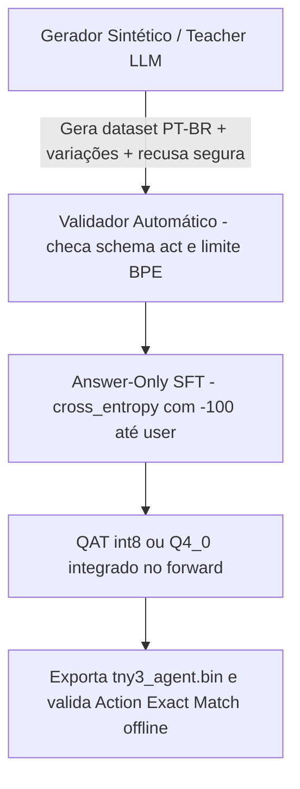

# Módulo 5 — A Fábrica de Dados: Destilação, Domínio Fechado e Micro-RAG

> **Carga horária sugerida:** 4 horas  
> **Hardware padrão:** `ESP32-S3-WROOM-1 (16MB)`  
> **Arquivos de referência do repo:** [`tools/finetune_tiny.py`](../../tools/finetune_tiny.py), [`tools/generate_brazil_dataset.py`](../../tools/generate_brazil_dataset.py), [`tools/txt_to_jsonl.py`](../../tools/txt_to_jsonl.py), [`TinyESP32/tiny_session.cpp`](../../TinyESP32/tiny_session.cpp), [`data/custom_qa.txt`](../../data/custom_qa.txt)

---

## Objetivos de Aprendizagem

Ao concluir este módulo, o aluno será capaz de:
1. Explicar por que **SLMs (*Small Language Models*)** alcançam alta confiabilidade como **modelos especialistas para ações (`<|act|>`) e Micro-RAG**.
2. Construir uma fábrica de **dados sintéticos variados com validação de schema e recusa segura**.
3. Executar **Answer-Only SFT + QAT** integrando o tokenizador BPE (Módulo 3) com o Transformer moderno `TNY3` (Módulo 4).
4. Substituir as regras manuais em [`TinyESP32/tiny_session.cpp`](../../TinyESP32/tiny_session.cpp) compilando uma partição binária de Micro-RAG (`rag_kb.bin`) para os 4 MB reservados no ESP32-S3.

---

## Arquivos Práticos Deste Módulo

| Arquivo na Pasta do Módulo | Tipo | Para Que Serve |
| :--- | :---: | :--- |
| [`lab01_gerar_dataset_sintetico.py`](./lab01_gerar_dataset_sintetico.py) | Python | Gera `out/dataset_sft.jsonl` e `out/dataset_eval.jsonl` (Trilha A `<|act|>` + Trilha B Micro-RAG + recusas seguras), valida schema e orçamento BPE + inclui template Teacher |
| [`data/fichas_emergencia_rag.txt`](./data/fichas_emergencia_rag.txt) | Base RAG | Fichas técnicas curtas de primeiros socorros, defesa civil e água potável em português |
| [`rag_builder.py`](./rag_builder.py) | Python | Compila as fichas no formato binário alinhado `RAG1` (`out/rag_kb.bin`) para a partição `rag_kb` e testa busca léxica em microssegundos |
| [`lab03_treinar_e_avaliar_tny3.py`](./lab03_treinar_e_avaliar_tny3.py) | Python | Treina BPE + `Tny3Transformer` com Answer-Only SFT + QAT, exporta `out/tny3_agent.bin` e mede `Action Exact Match` e `Safe Refusal Rate` em frases inéditas |
| [`.gitignore`](./.gitignore) | Config | Ignora `out/` e `__pycache__/` |

---

## 1. A Virada de Chave: O Que Cabe em Poucos Milhões de Parâmetros?

Pesquisas como *TinyStories* e *Phi* provaram duas verdades fundamentais para modelos compactos:

1. **Qualidade > Volume Bruto:** Dados sintéticos limpos, variados e focados em um domínio geram muito mais confiabilidade do que texto ruidoso da web.
2. **Separe "Raciocínio Linguístico" de "Memória Factual":**
   * **O que o mini-LLM aprende nos pesos:** entender intenções coloquiais, ler blocos `<|ctx|>`, emitir comandos estruturados `<|act|>` e redigir respostas ou recusas seguras (`NONE`).
   * **Onde vivem os fatos mutáveis ou extensos:** no contexto em tempo real (**sensores** + **Micro-RAG** na partição `rag_kb` de 4 MB da Flash!).

---

## 2. Os Dois Casos de Uso Úteis do Curso

### Trilha A — Agente IoT ("Do Prompt ao Pino")
```text
<|bos|><|ctx|>temp=31C;luz=20%;fan=0;led=off;relay=0<|user|>tá muito abafado aqui, liga o vento forte<|act|>FAN=100<|assistant|>Ventilador ligado em 100% (temperatura em 31°C).<|eos|>
```

### Trilha B — Copiloto Offline de Emergência (Evolução do AMEBA)
Conecta diretamente com [`TinyESP32/tiny_session.cpp`](../../TinyESP32/tiny_session.cpp) e [`data/custom_qa.txt`](../../data/custom_qa.txt): em vez de manter `FOLLOWUP_RULES[]` com ~900 linhas manuais, o [`rag_builder.py`](./rag_builder.py) empacota as fichas técnicas em `RAG1` (`rag_kb.bin`), recupera a ficha certa em `< 1 ms` e a injeta em `<|ctx|>`.

---

## 3. Pipeline de Dados e Treino



---

## 4. Laboratório Prático — Da Fábrica de Dados ao Modelo Avaliado

Execute os 3 scripts do módulo em sequência a partir da raiz do repositório:

```bash
# 1) Gerar e validar dataset sintético (treino + avaliação inédita)
python curso/modulo-05-fabrica-dados-destilacao/lab01_gerar_dataset_sintetico.py

# 2) Compilar a partição binária de Micro-RAG (RAG1) e testar busca léxica
python curso/modulo-05-fabrica-dados-destilacao/rag_builder.py

# 3) Treinar o modelo TNY3 especialista (QAT int8) e rodar matriz de avaliação
python curso/modulo-05-fabrica-dados-destilacao/lab03_treinar_e_avaliar_tny3.py
```

*(Dica: adicione `--q4` no passo 3 para treinar e validar a versão quantizada em 4 bits `Q4_0`, ou `--preset full_s3` se quiser treinar a escala completa.)*

Critérios esperados na matriz de avaliação sobre frases inéditas:
* **Action Exact Match:** >= 90%
* **Safe Refusal Rate (`NONE`):** >= 95% (zero acionamento acidental de relé/LED!)
* **Formatação Válida (`<|act|>...<|assistant|>`):** 100%

---

## 5. Exercícios do Módulo

1. **Auditoria de [`tiny_session.cpp`](../../TinyESP32/tiny_session.cpp):** Leia `try_rewrite_followup` e compare com a busca de [`rag_builder.py`](./rag_builder.py) usando `last_topic`. Quais manutenções deixam de existir?
2. **Custo de Alucinação em Atuadores:** Edite [`lab01_gerar_dataset_sintetico.py`](./lab01_gerar_dataset_sintetico.py) adicionando 5 novos pedidos perigosos ou fora de escopo em `eval_rows` e confirme que a taxa de falsos acionamentos continua `0`.
3. **Expansão com Teacher:** Use a constante `TEACHER_PROMPT_TEMPLATE` de [`lab01_gerar_dataset_sintetico.py`](./lab01_gerar_dataset_sintetico.py) com um LLM grande para ampliar o vocabulário mantendo o formato JSONL validado.

---

| Anterior | Índice | Próximo |
| :--- | :---: | :--- |
| [← Módulo 4: Arquitetura Moderna TNY3-S3](../modulo-04-arquitetura-tny3-s3/README.md) | [Guia do Curso](../README.md) | [Módulo 6: Projeto Final — SIMD, Dual-Core e Agente Físico →](../modulo-06-agente-embarcado-simd/README.md) |
