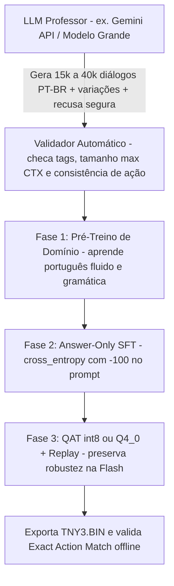

# Módulo 5 — A Fábrica de Dados: Destilação, Domínio Fechado e Micro-RAG

> **Carga horária sugerida:** 4 horas  
> **Hardware padrão:** `ESP32-S3-WROOM-1 (16MB)`  
> **Arquivos de referência do repo:** [`tools/finetune_tiny.py`](../../tools/finetune_tiny.py), [`tools/generate_brazil_dataset.py`](../../tools/generate_brazil_dataset.py), [`tools/txt_to_jsonl.py`](../../tools/txt_to_jsonl.py), [`TinyESP32/tiny_session.cpp`](../../TinyESP32/tiny_session.cpp), [`data/custom_qa.txt`](../../data/custom_qa.txt)

---

## Objetivos de Aprendizagem

Ao concluir este módulo, o aluno será capaz de:
1. Explicar por que **SLMs (*Small Language Models*) de 5M–10M parâmetros** falham em "conhecimento enciclopédico aberto", mas atingem altíssima confiabilidade como **modelos especialistas e interfaces de linguagem para ações/RAG**.
2. Construir um pipeline de **Destilação Sintética (Teacher → Student)** gerando milhares de exemplos limpos em PT-BR usando um LLM grande como professor.
3. Aplicar treinamento em **3 estágios** (Pré-treino de domínio → Answer-Only SFT → QAT `int8`/`Q4_0`) evitando alucinação e esquecimento catastrófico.
4. Aposentar as regras manuais em [`TinyESP32/tiny_session.cpp`](../../TinyESP32/tiny_session.cpp) combinando o **histórico multi-turno no KV Cache** com um **Micro-RAG armazenado na partição `rag_kb` (4 MB)** do ESP32-S3.

---

## 1. A Virada de Chave: O Que Cabe em 7 Milhões de Parâmetros?

Tentativas de colocar fatos históricos aleatórios ou geografia universal em um modelo de poucos megabytes sempre levam à memorização frágil (como vimos no Módulo 1). Pesquisas como *TinyStories* e *Phi* provaram duas verdades fundamentais para modelos minúsculos:

1. **Qualidade > Volume Bruto:** 10 MB de dados sintéticos limpos, gramaticalmente consistentes e focados em um domínio geram um modelo muito mais inteligente do que 500 MB de texto ruidoso da web.
2. **Separe "Raciocínio Linguístico" de "Memória Factual":**
   * **O que o mini-LLM aprende nos pesos:** entender intenções em português coloquial, ler blocos `<|ctx|>`, emitir chamadas estruturadas `<|act|>` e redigir respostas naturais ou recusar o que não sabe.
   * **Onde vivem os fatos mutáveis ou extensos:** no contexto em tempo real (**sensores** + **Micro-RAG** na partição de 4 MB da Flash!).

---

## 2. Os Dois Casos de Uso Úteis do Curso

Para que o modelo que cabe no ESP32-S3 tenha utilidade real (e não seja apenas um brinquedo de perguntas fixas), o curso trabalha duas trilhas sobre a mesma arquitetura `TNY3-S3`:

### Trilha A — Agente IoT ("Do Prompt ao Pino")
Traduz fala humana ambígua + estado dos sensores em **ações determinísticas** e feedback cordial:

```text
<|bos|><|ctx|>temp=31C;umid=78%;luz=20%;fan=0;led=off<|user|>tá muito abafado aqui e escuro, dá um jeito<|act|>FAN=100;LED=WARM<|assistant|>Está bem quente mesmo (31°C). Liguei a ventilação no máximo e acendi a luz em tom quente.<|eos|>
```

* **Por que um modelo de 7M params é útil aqui?** Expressões como *"tá um forno"*, *"baixa esse vento"*, *"apaga tudo que vou dormir"* têm infinitas variações que quebram `if/else` simples — mas um Transformer BPE destilado com 15.000 variações coloquiais generaliza com precisão >95% offline!

### Trilha B — Copiloto Offline de Emergência e Campo (Evolução do AMEBA)
Conecta diretamente com o propósito humanitário já presente em [`TinyESP32/tiny_session.cpp`](../../TinyESP32/tiny_session.cpp) e [`data/custom_qa.txt`](../../data/custom_qa.txt) (primeiros socorros, defesa civil, sobrevivência e conectividade isolada):

* Em vez de tentar comprimir todos os manuais dentro dos pesos neurais — ou manter `FOLLOWUP_RULES[]` com quase mil linhas manuais — gravamos centenas de **fichas técnicas curtas** na partição `rag_kb` (4 MB na Flash).
* Quando o usuário pergunta: *"Ele engoliu muita água da piscina e agora tá tossindo, o que faço?"*, uma busca BM25/léxica ultrarrápida em C (< 5 ms) recupera a ficha certa e injeta em `<|ctx|>`.
* O `TNY3-S3` lê `<|ctx|>` + a pergunta + o turno anterior (que agora cabe na janela `CTX = 256/512`!) e responde de forma coesa e segura.

---

## 3. Pipeline de Dados e Treino em 3 Estágios



### Regras de Ouro da Fábrica de Dados (Aprendidas com o Repo)

1. **Variação Real de Fala + Erros de Digitação:**
   Assim como `perturb_question()` em [`tools/finetune_tiny.py`](../../tools/finetune_tiny.py#L94-L108) injeta pequenos erros tipográficos durante o treino, o gerador sintético deve incluir gírias, frases sem pontuação, abreviações (`"vc"`, `"pq"`, `"tá"`) e perguntas indiretas.
2. **Exemplos Negativos e Recusa Segura (Anti-Alucinação):**
   Como já praticado nas linhas `54–62` de [`data/custom_qa.txt`](../../data/custom_qa.txt#L54-L62), **10% a 15% do dataset** deve conter perguntas impossíveis, fora de domínio ou leituras contraditórias de sensores onde o modelo aprende a emitir `<|act|>NONE` e dizer claramente que não tem aquela informação ou função.
3. **Answer-Only SFT + Replay + L2-SP:**
   Mantemos a técnica comprovada de [`tools/finetune_tiny.py`](../../tools/finetune_tiny.py#L511-L517):
   * Mascarar os tokens do prompt (`<|bos|>...<|user|>...`) com `-100` na `cross_entropy` para que o modelo concentre **100% do gradiente** em acertar `<|act|>` e `<|assistant|>`.
   * Usar **Replay Buffer** com perguntas-âncora e regularização leve para não destruir a fluência básica do português durante o ajuste fino.

---

## 4. Laboratório Prático — Gerando Dados e Medindo Utilidade Real

1. **Desenho do Esquema de Ferramentas (`Schema`):**
   Defina de 4 a 6 ações físicas suportadas pelo hardware do Módulo 6 (ex.: `FAN=0..100`, `LED=OFF|WARM|COOL|ALERT`, `RELAY=0|1`, `READ=TEMP|LIGHT`, `NONE`).
2. **Geração via Script Professor (`tools/distill_dataset.py`):**
   * Escreva um prompt estruturado que instrua o modelo professor a gerar lotes JSONL com `{"ctx": ..., "history": ..., "user": ..., "act": ..., "assistant": ...}` cobrindo todos os comandos, combinações múltiplas (*"liga a luz e desliga o cooler"*), follow-ups (*"aumenta mais um pouco"*) e recusas seguras.
   * Valide programaticamente que 100% das amostras respeitam a sintaxe `<|act|>` e cabem em `CTX = 256` tokens usando o tokenizador BPE do Módulo 3!
3. **Treinamento & Matriz de Avaliação Automatizada:**
   Antes de gravar na placa, rode uma suíte de validação quantizada (evolução do bloco `[EVAL]` de [`finetune_tiny.py`](../../tools/finetune_tiny.py#L780-L795)) medindo:
   * **Acurácia exata de ação (`Action Exact Match`):** meta ≥ 93% em prompts inéditos de teste.
   * **Taxa de recusa segura (`Safe Refusal`):** meta ≥ 95% em perguntas fora de escopo (zero acionamento acidental de relé!).
   * **Taxa de formatação válida:** 100% das gerações encerrando com `<|eos|>` e parseáveis pelo parser em C.

---

## 5. Exercícios do Módulo

1. **Auditoria de [`tiny_session.cpp`](../../TinyESP32/tiny_session.cpp):** Leia `try_rewrite_followup` e explique dois casos em que o sistema de regras manuais falha (ex.: troca rápida de tópico ou pergunta ambígua) e mostre como o formato multi-turno com `<|ctx|>` no BPE resolve isso naturalmente.
2. **Custo de Alucinação em Atuadores:** Em um agente IoT com relés reais, qual erro é mais grave: *falso negativo* (não entender o pedido e responder `<|act|>NONE`) ou *falso positivo* (inventar um comando `RELAY=1` em uma pergunta aleatória)? Como ajustar o dataset de treinamento para punir falsos positivos?
3. **Micro-RAG na Flash:** Projete um índice simples (lista de palavras-chave + offset na partição `rag_kb` de 4 MB) capaz de localizar a melhor ficha de 120 tokens dentre 1.000 fichas em menos de 10 ms no ESP32-S3 sem usar JSON pesado em RAM.

---

| Anterior | Índice | Próximo |
| :--- | :---: | :--- |
| [← Módulo 4: Arquitetura Moderna TNY3-S3](../modulo-04-arquitetura-tny3-s3/README.md) | [Guia do Curso](../README.md) | [Módulo 6: Projeto Final — SIMD, Dual-Core e Agente Físico →](../modulo-06-agente-embarcado-simd/README.md) |
