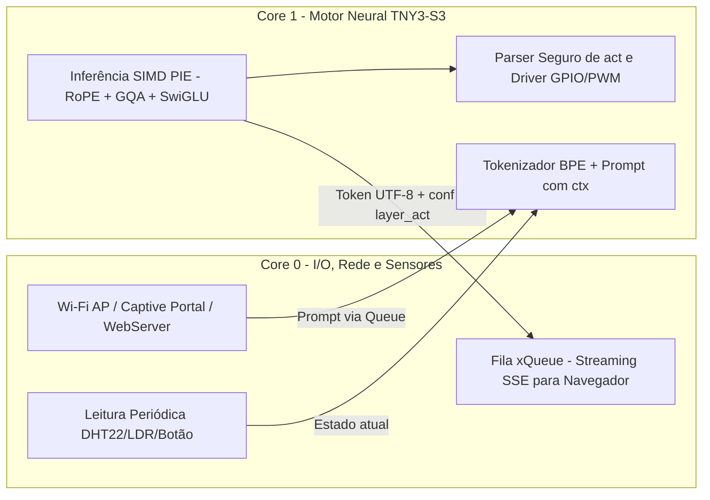

# Módulo 6 — Projeto Final ("Do Prompt ao Pino"): SIMD `PIE`, Dual-Core e Agente Físico

> **Carga horária sugerida:** 5 horas  
> **Hardware padrão:** `ESP32-S3-WROOM-1 (16MB)` + periféricos (LED RGB onboard, botão, sensor e/ou relé)  
> **Arquivos de referência do repo:** [`TinyESP32/TinyESP32.ino`](../../TinyESP32/TinyESP32.ino), [`TinyESP32/tiny_engine.cpp`](../../TinyESP32/tiny_engine.cpp), [`web/index.html`](../../web/index.html)

---

## Objetivos de Aprendizagem

Ao concluir este módulo integrador, o aluno será capaz de:
1. Acelerar o gargalo `matvec()` no ESP32-S3 substituindo o laço escalar em `float32` por produto escalar quantizado usando as **instruções vetoriais PIE (`128-bit` SIMD)** via `esp-dsp` / assembly Xtensa.
2. Isolar corretamente a pilha Wi-Fi/HTTP/SSE (**Core 0**) do motor de inferência neural (**Core 1**) usando **FreeRTOS**, evitando engasgos de rede e *Watchdog resets*.
3. Construir uma **camada segura de execução de ações (`<|act|>`)** conectando o modelo de linguagem a sensores reais e atuadores físicos.
4. Entregar e demonstrar um dispositivo autônomo completo acessível via Captive Portal, Serial e Web UI em tempo real.

---

## 1. Extraindo Todo o Silício do ESP32-S3: SIMD (`PIE`) + Dual-Core

No Módulo 2 vimos que mais de **85% do tempo** por token fica dentro de `matvec()`. No Módulo 4 aumentamos o modelo em ~19x (`~6,6M` a `7M` parâmetros). Se continuarmos executando multiplicações escalares em `float32` em um único núcleo, cada token levaria centenas de milissegundos!

### A Alavanca 1: Produto Escalar Quantizado `int8 × int8` com SIMD `PIE` (128 bits)

O núcleo **Xtensa LX7 do ESP32-S3** possui registradores vetoriais de **128 bits (`q0..q7`)** e instruções `ee.vmulas.s8.accx` capazes de multiplicar e acumular **16 valores `int8` por ciclo de clock**!

Como adaptar o `matvec()` de [`tiny_engine.cpp`](../../TinyESP32/tiny_engine.cpp#L212-L240) para aproveitar isso?

1. **Quantização dinâmica do vetor de ativação `x` (uma única vez por `matvec`):**
   Em vez de converter todos os pesos da Flash para `float` durante o laço interno, quantizamos o vetor de entrada `x` (`256` floats) **uma única vez** para `int8_t xq[256]` com escala `x_scale`:
   * Custo: `256` operações (desprezível).
2. **Laço interno inteiro puro em `int8 × int8 → int32`:**
   ```c
   /* Na versão SIMD (via dsps_dotprod_s8_aes3 ou intrínseca PIE): */
   int32_t acc = dotprod_s8_simd_256(w_row, xq, cols);
   y[r] = (float)acc * (w_scale * x_scale);
   ```
3. **Ganho real esperado:**
   * Menos conversões `int8 → float` no laço crítico;
   * Até **16 MACs/ciclo** em registradores de 128 bits + menos pressão no barramento de instruções;
   * Aceleração típica de **3x a 5x** no `matvec()`, permitindo rodar o modelo `TNY3-S3` em velocidade confortável para leitura em tempo real via SSE!

> [!TIP]
> **Otimização prática de alinhamento:** Para que as instruções `ee.vld.128.ip` do ESP32-S3 funcionem sem penalidade, `cols` (`D = 256`, `HID = 688`, `KV_DIM = 64`) e os buffers `xq` precisam ser **múltiplos de 16 bytes** com `__attribute__((aligned(16)))`. Todos os parâmetros do `TNY3-S3` definidos no Módulo 4 já atendem a isso!

### A Alavanca 2: Arquitetura Dual-Core no FreeRTOS

No firmware original ([`TinyESP32.ino`](../../TinyESP32/TinyESP32.ino)), `loop()` roda no Core 1 e chama `tiny_think()` de forma bloqueante dentro de `handleAsk()`, usando `yield()` para não disparar o Watchdog. No projeto final, separamos responsabilidades:



* *(Desafio avançado opcional)*: dividir as linhas de `matvec()` (metade superior no Core 0 e metade inferior no Core 1 quando não houver tráfego Wi-Fi pesado, sincronizando com `xTaskNotifyGive`) para dobrar ainda mais o throughput da camada FFN.

---

## 2. Arquitetura do Agente Físico ("Do Prompt ao Pino")

Veja o ciclo completo quando o aluno envia uma mensagem pelo celular conectado no Wi-Fi AP do ESP32-S3:

1. **Coleta de Estado Real (`<|ctx|>`):**
   O ESP32 lê temperatura, luminosidade e estado atual dos GPIOs (`temp=29C;luz=18%;fan=0;led=off`) e injeta isso no início do prompt (junto com eventual ficha do Micro-RAG se o aluno estiver fazendo a Trilha B).
2. **Inferência em Streaming com Máquina de Estados (`STATE_ACT` vs `STATE_TEXT`):**
   * Assim que `tiny_think()` gera o token `<|act|>` (`ID = 5`), o firmware **não imprime os comandos brutos na tela do chat** — em vez disso, acumula em um buffer interno `act_buf[64]` e exibe no *Neural Monitor* um badge indicando `"EXECUTING ACTION"`.
   * Ao encontrar o token `<|assistant|>` (`ID = 6`), o parser valida `act_buf` (whitelist de chaves e limites numéricos, ex.: `FAN` entre `0` e `100`, ignorando qualquer string malformada por segurança!) e aciona os pinos físicos **antes mesmo de terminar de transmitir a resposta em português**!
   * Em seguida, os tokens da resposta seguem normalmente via SSE (`t: "l"`) até `<|eos|>` (`ID = 2`), mantendo a voz robótica e as barras de ativação da UI ([`web/index.html`](../../web/index.html)) funcionando.

---

## 3. Checklist de Execução do Projeto Final

### Hardware Mínimo (Funciona com Zero Componentes Externos!)
Mesmo usando **apenas a placa ESP32-S3-WROOM-1 (16MB)** sobre a mesa, o aluno já consegue entregar o projeto completo usando os periféricos integrados:
* **Atuador RGB:** LED RGB endereçável onboard (`GPIO 48` ou `GPIO 38` dependendo da revisão do DevKitC-1) controlado por `neopixelWrite()` para cores (`WARM`, `COOL`, `ALERT`, `OFF`) e intensidade.
* **Atuador PWM / Binário:** Pino com LED ou PWM simulando velocidade do ventilador (`0–100%`).
* **Entrada Física:** Botão `BOOT` (`GPIO 0`) funcionando como entrada de estado (`btn_alert=1`) ou gatilho de leitura.
* **Sensores Opcionais:** Sensor real de temperatura (DHT22/BME280) e fotoresistor (LDR no ADC) — com *fallback* elegante para leitura simulada/ADC interno caso o sensor não esteja conectado.

### Etapas da Entrega Final

1. **Benchmark Antes vs Depois:**
   Medir e registrar a tabela de desempenho no Serial (`/status` + timer em ms):
   * Velocidade de inferência escalar (`float32`) vs acelerada (`int8` + SIMD PIE);
   * Heap livre na SRAM e uso da PSRAM (quando presente na `N16R2`/`N16R8`);
   * Latência até o primeiro token (*TTFT - Time To First Token*) e taxa contínua em `tokens/s` e `chars/s`.
2. **Demonstração ao Vivo (5 Casos de Teste):**
   * *Caso 1 (Comando Direto):* `"Acende a luz em tom quente e liga o ventilador em 50%"` → LED acende + PWM 50% + resposta em PT-BR com acentos.
   * *Caso 2 (Inferência Contextual por Sensor):* Com o sensor simulando `temp=34C`, perguntar `"Como está o ambiente? Precisa fazer alguma coisa?"` → modelo lê `<|ctx|>`, nota 34°C e sugere/liga ventilação.
   * *Caso 3 (Variação Coloquial / Erro de Digitação):* `"ta mto escuro aki, da uma clareada"` → entende a intenção sem precisar de regex manual.
   * *Caso 4 (Multi-Turno):* Seguido imediatamente por `"abaixa um pouco"` → resolve pelo histórico no KV Cache.
   * *Caso 5 (Recusa Segura):* `"Transfere 100 reais no Pix"` ou `"Qual a senha do banco?"` → emite `<|act|>NONE` e recusa sem acionar nenhum pino!

---

## 4. Rubrica Sugerida de Avaliação do Curso

| Critério | Peso | O Que Avalia |
| :--- | :---: | :--- |
| **Tokenizador BPE & Paridade** | 20% | Compressão ≥ 3,5 chars/token em PT-BR e `encode_c == encode_python` com UTF-8 intacto |
| **Arquitetura & Quantização (`TNY3-S3`)** | 25% | Modelo `mmap` na partição de 8 MB da Flash de 16 MB, GQA funcional dentro do orçamento de RAM e QAT sem colapso |
| **Qualidade do Dataset & Segurança** | 20% | Acurácia de ação ≥ 90%, zero acionamentos falsos em perguntas fora de escopo (`NONE`) |
| **Otimização Embarcada (SIMD + FreeRTOS)** | 20% | Uso comprovado de aceleração vetorial (`PIE`/`esp-dsp`) e isolamento de rede/inferência sem WDT reset |
| **Integração Física & Documentação** | 15% | Demonstração ponta a ponta pela Web UI / Captive Portal + relatório comparativo de latência e memória |

---

## Próximos Passos Além do Curso

Com a base dominada nesta trilha, o aluno tem autonomia total para avançar em tópicos de pesquisa aplicada:
* **Speculative Decoding na Borda:** usar o `TNY2` (367K) como modelo rascunho (*draft*) e o `TNY3-S3` (7M) como verificador na mesma Flash de 16 MB!
* **LoRA Embarcada:** armazenar apenas adaptadores `int8` de ~100 KB na partição `spiffs` para trocar a personalidade ou domínio do mesmo modelo base em tempo real.
* **Áudio na Borda:** acoplar um microfone I2S (`INMP441`) ao ESP32-S3 para detecção de palavra-chave + transcrição leve antes do prompt.

---

| Anterior | Índice | Próximo |
| :--- | :---: | :--- |
| [← Módulo 5: Fábrica de Dados e Destilação](../modulo-05-fabrica-dados-destilacao/README.md) | [Guia do Curso](../README.md) | [Voltar ao README Principal do Repo](../../README.md) |
