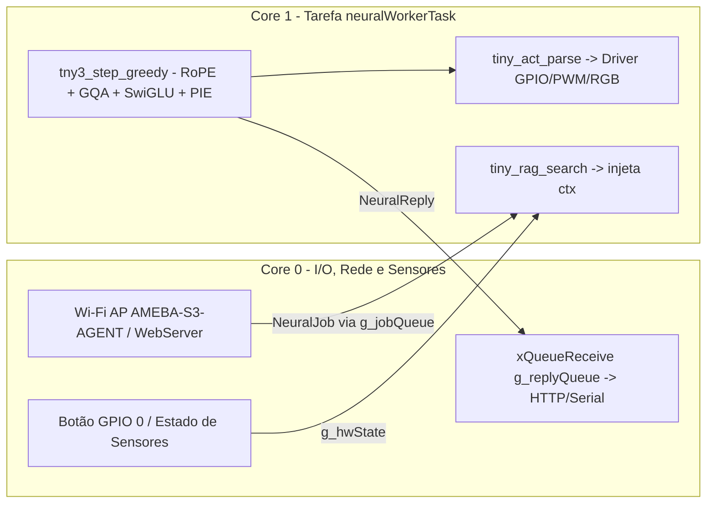

# Módulo 6 — Projeto Final ("Do Prompt ao Pino"): SIMD `PIE`, Dual-Core e Agente Físico

> **Carga horária sugerida:** 5 horas  
> **Hardware padrão:** `ESP32-S3-WROOM-1 (16MB)` + periféricos (LED RGB onboard, botão, sensor e/ou relé)  
> **Arquivos de referência do repo:** [`TinyESP32/TinyESP32.ino`](../../TinyESP32/TinyESP32.ino), [`TinyESP32/tiny_engine.cpp`](../../TinyESP32/tiny_engine.cpp), [`web/index.html`](../../web/index.html)

---

## Objetivos de Aprendizagem

Ao concluir este módulo integrador, o aluno será capaz de:
1. Acelerar o gargalo `matvec()` no ESP32-S3 substituindo o laço escalar em `float32` por produto escalar quantizado (`int8 × int8 -> int32`) usando as **instruções vetoriais PIE (`128-bit` SIMD)**.
2. Isolar corretamente a pilha Wi-Fi/HTTP/SSE (**Core 0**) do motor de inferência neural (**Core 1**) usando **FreeRTOS**, evitando engasgos de rede e *Watchdog resets*.
3. Construir uma **camada segura de execução de ações (`<|act|>`)** com whitelist estrita conectando o modelo a sensores reais e atuadores físicos.
4. Entregar e validar ponta a ponta o projeto final em hardware e em simulação integrada.

---

## Arquivos Práticos Deste Módulo

| Arquivo na Pasta do Módulo | Tipo | Para Que Serve |
| :--- | :---: | :--- |
| [`TinyAgentS3/TinyAgentS3.ino`](./TinyAgentS3/TinyAgentS3.ino) | Arduino C++ | Sketch principal FreeRTOS Dual-Core (Core 0 Wi-Fi/Captive Portal/SSE + Core 1 Tarefa Neural), comandos `/status`, `/bench`, `/temp`, `/act` |
| [`TinyAgentS3/tny3_engine.h`](./TinyAgentS3/tny3_engine.h) e [`.cpp`](./TinyAgentS3/tny3_engine.cpp) | Motor C/C++ | Executor `TNY3` (`int8` e `Q4_0`) com RoPE, GQA, SwiGLU, buffers `aligned(16)`, modo `INT8_MAC4` e kernel assembly `PIE` (`ee.vmulas.s8.accx`) |
| [`TinyAgentS3/tiny_act.h`](./TinyAgentS3/tiny_act.h) e [`.cpp`](./TinyAgentS3/tiny_act.cpp) | Segurança HW | Parser com whitelist estrita (`FAN 0..100`, `LED OFF/WARM/COOL/ALERT`, `RELAY 0/1`, `NONE`) acionando LED RGB onboard + PWM + relé |
| [`TinyAgentS3/tiny_rag.h`](./TinyAgentS3/tiny_rag.h) e [`.cpp`](./TinyAgentS3/tiny_rag.cpp) | Micro-RAG C | Leitor `RAG1` na partição `rag_kb` (4 MB) com fallback `PROGMEM` |
| [`lab06_benchmark_e_validacao.py`](./lab06_benchmark_e_validacao.py) | Python | Valida fidelidade numérica SIMD (`int8×int8`), testa 20 casos de segurança do parser, audita todos os `.h/.cpp/.ino` do curso e executa os casos Capstone |
| [`.gitignore`](./.gitignore) | Config | Ignora `out/` e `__pycache__/` |

---

## 1. Extraindo Todo o Silício do ESP32-S3: SIMD (`PIE`) + Dual-Core

No Módulo 2 vimos que mais de **95% das operações** ficam dentro de `matvec()`. Em [`TinyAgentS3/tny3_engine.cpp`](./TinyAgentS3/tny3_engine.cpp), implementamos três modos comutáveis em tempo real pelo comando `/bench`:

1. **`TNY3_MATVEC_FP32_SCALAR`:** laço escalar `float32` com unroll 4x (referência).
2. **`TNY3_MATVEC_INT8_MAC4`:** quantiza o vetor de entrada `x` para `int8_t bxq[]` uma única vez (`quantize_vec_int8`) e executa acumulação inteira pura `int8 × int8 → int32`.
3. **`TNY3_MATVEC_S3_PIE_SIMD`:** usa os registradores de 128 bits (`q0, q1`) e `ee.vmulas.s8.accx` do Xtensa LX7 (quando `TNY3_USE_PIE_ASM` está habilitado) sobre buffers `__attribute__((aligned(16)))`.

### Arquitetura Dual-Core no FreeRTOS ([`TinyAgentS3.ino`](./TinyAgentS3/TinyAgentS3.ino))



---

## 2. Segurança Física ("Do Prompt ao Pino")

Em [`TinyAgentS3/tiny_act.cpp`](./TinyAgentS3/tiny_act.cpp), nenhum comando gerado pela LLM toca um pino físico sem passar por `tiny_act_parse()`:
* Aceita apenas `NONE` ou combinações com `;` das chaves `FAN=0..100`, `LED=OFF|WARM|COOL|ALERT`, `RELAY=0|1`.
* Qualquer chave desconhecida (`DOOR=OPEN`), valor fora de faixa (`FAN=999`) ou texto malformado **aborta o comando inteiro** retornando `false`.

---

## 3. Laboratório Integrador Final — Executando e Validando Tudo

### Passo 1: Validação Integrada no PC (Módulos 3 + 4 + 5 + 6)
Execute na raiz do repositório:

```bash
python curso/modulo-06-agente-embarcado-simd/lab06_benchmark_e_validacao.py
```

O script executa automaticamente:
1. Auditoria de **20 casos de segurança** do parser `<|act|>` (incluindo tentativas de injeção e valores inválidos);
2. Verificação estática de todos os arquivos `.ino`/`.h`/`.cpp` criados nos Módulos 2, 3, 4 e 6 (chaves balanceadas, UTF-8, proibição de `double` em `tny3_engine.cpp` e buffers `aligned(16)`);
3. Fidelidade numérica `int8 × int8` (SIMD PIE) vs `float32 × int8` (`Cosine Similarity > 0,995`);
4. Simulação ponta a ponta dos **5 casos Capstone** + consulta **Micro-RAG** usando o modelo treinado no Módulo 5!

### Passo 2: Subir no `ESP32-S3-WROOM-1 (16MB)`
1. Copie [`partitions_s3_16mb.csv`](../modulo-04-arquitetura-tny3-s3/partitions_s3_16mb.csv) como `partitions.csv` dentro de `TinyAgentS3/`.
2. Compile e faça upload de [`TinyAgentS3.ino`](./TinyAgentS3/TinyAgentS3.ino) na Arduino IDE (`ESP32S3 Dev Module`, `16MB`, `USB CDC On Boot: Enabled`).
3. *(Opcional)* Grave os binários gerados no Módulo 5 direto nas partições de Flash sem recompilar o firmware:
   ```bash
   esptool.py --chip esp32s3 write_flash 0x290000 curso/modulo-05-fabrica-dados-destilacao/out/tny3_agent.bin 0xA90000 curso/modulo-05-fabrica-dados-destilacao/out/rag_kb.bin
   ```
4. Teste no Serial Monitor com `/status`, `/bench`, `/temp 34` e `/act LED=WARM;FAN=50` (ou acesse o Wi-Fi AP `AMEBA-S3-AGENT` em `http://192.168.4.1`).

---

## 4. Rubrica Sugerida de Avaliação do Curso

| Critério | Peso | O Que Avalia |
| :--- | :---: | :--- |
| **Tokenizador BPE & Paridade** | 20% | Compressão >= 3,5 chars/token em PT-BR e `encode_c == encode_python` com UTF-8 intacto |
| **Arquitetura & Quantização (`TNY3-S3`)** | 25% | Modelo `mmap` na partição de 8 MB da Flash de 16 MB, GQA funcional dentro do orçamento de RAM e QAT sem colapso |
| **Qualidade do Dataset & Segurança** | 20% | Acurácia de ação >= 90%, zero acionamentos falsos em perguntas fora de escopo (`NONE`) |
| **Otimização Embarcada (SIMD + FreeRTOS)** | 20% | Uso comprovado de aceleração vetorial (`PIE`/MAC4) e isolamento de rede/inferência sem WDT reset |
| **Integração Física & Documentação** | 15% | Demonstração ponta a ponta pela Web UI / Captive Portal + relatório comparativo de latência e memória |

---

## Próximos Passos Além do Curso

* **Speculative Decoding na Borda:** usar o `TNY2` (367K) como modelo rascunho (*draft*) e o `TNY3-S3` (7M) como verificador na mesma Flash de 16 MB!
* **LoRA Embarcada:** armazenar apenas adaptadores `int8` de ~100 KB na partição `spiffs` para trocar o domínio do modelo base em tempo real.
* **Áudio na Borda:** acoplar um microfone I2S (`INMP441`) ao ESP32-S3 para transcrição leve antes do prompt.

---

| Anterior | Índice | Próximo |
| :--- | :---: | :--- |
| [← Módulo 5: Fábrica de Dados e Destilação](../modulo-05-fabrica-dados-destilacao/README.md) | [Guia do Curso](../README.md) | [Voltar ao README Principal do Repo](../../README.md) |
